# Duck Mold: Phase 4 report

Phase 4 is built, as designed in `DESIGN.md` section 20 and approved
with all twelve decisions as recommended, in nine steps, one commit
each, on the branch `claude/duck-mold-phase-4`. That branch was made
from `claude/duck-mold-phase-3`, which is still not merged: I haven't
merged it. No pull request has been opened: say so when you want one.

The four rules still hold. The recipe is the model. Every Studio action
that changes the model is an edit command an agent can run too. An edit
changes only what it has to in the file. The viewport is Duck Forge's
CPU renderer.

## In short

A box can now be shaped by hand. Select it, press Tab, and click its
faces: pull them out or push them in, inset them, slide, turn and scale
them. E shows its edges and C its corners, to move them; K cuts round
it. Every one of these is one line in the part's `changes` list in the
recipe, in words:

```toml
changes = [
  { cut = "left", at = 0.8 },
  { pull = "bottom_left_front", by = 0.42, name = "leg_lf" },
  { inset = "front", by = 0.6, name = "window" },
  { move = "top+front+left", by = [0, 0.2, 0] },
]
```

Faces, edges and corners are named by words that come down from the
box (`top_left_back`, `backrest_front`, `top+front+left`), never by a
number, so the names stay put when the box is resized. A new face can
be painted and carry a socket, like the box's own. A shaped part can be
made a definition or saved to the library. After any list of changes
the shape is checked to be closed, facing outwards and not passing
through itself; a change that would break it is refused, and the
Studio says why while you are still dragging.

Three new examples are each one box, shaped: a chair, a wall with a
framed window, and a rock. The house's windows are framed now.

The leftovers from Phase 3 are done (pictures in the Add menu, a
facing choice for sockets, remembered hidden parts, copies of joined
parts going to the next free socket), and so are the three fixes (`add`
with no place, copies sitting on the original, new parts "floating").

A Windows zip to try was built after step 2, as decision 12 said:
<https://github.com/mrguymrguy647-del/Duck-Mold/actions/runs/43440890666>.

## A picture of each new screen

Every picture below is a stored test picture: the tests draw the screen
again and fail if it no longer looks like this.

**Face mode** (step 2), on a wall with a framed window: the glass is
selected, the Pull arrow is on it, and the panel lists the wall's
changes, each with its amount to change and an x to take it away.

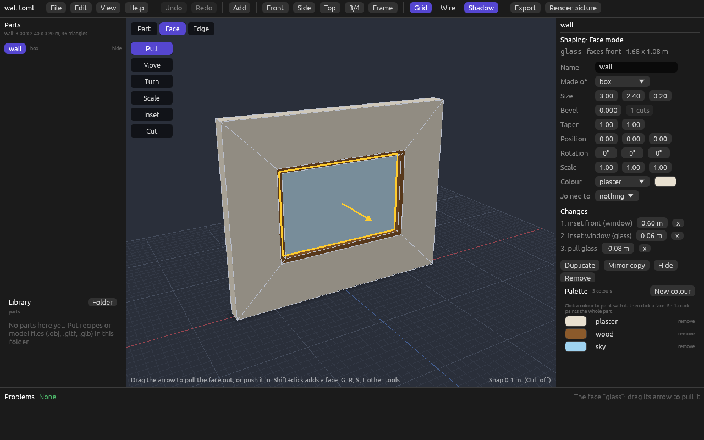

**A refused drag** (step 2): the glass held too far in, through the
back of the wall. The label beside the pointer is red and says why;
letting go writes nothing.

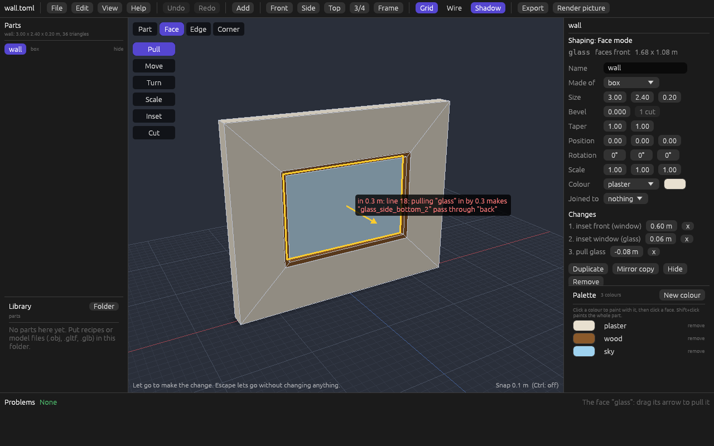

**Pull, inset, and a scaled face** (steps 2 and 3), in the viewport:

| Pulling | Inset | Scaled |
|---|---|---|
| 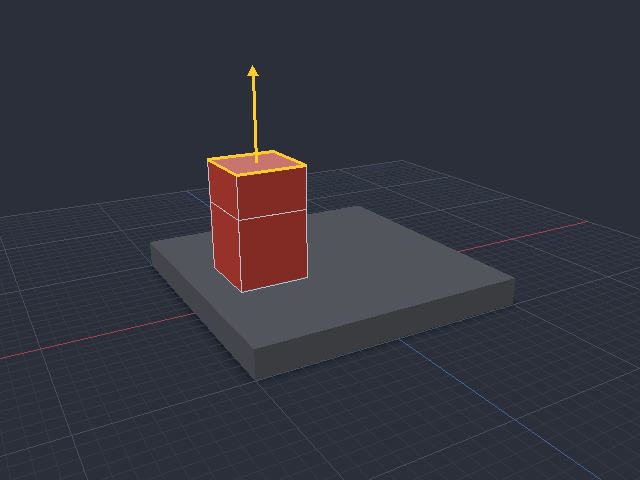 | 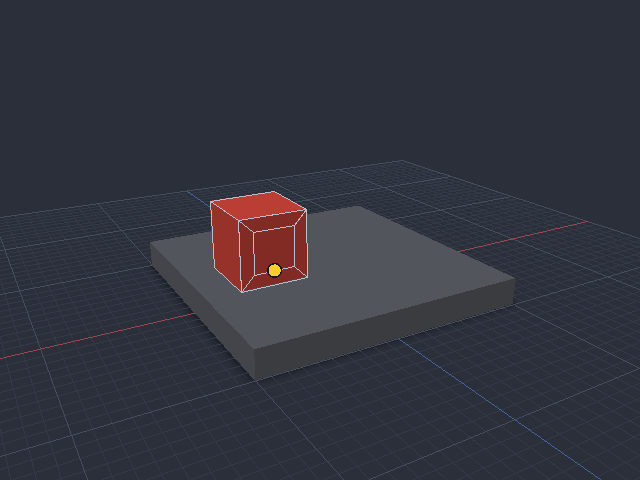 | 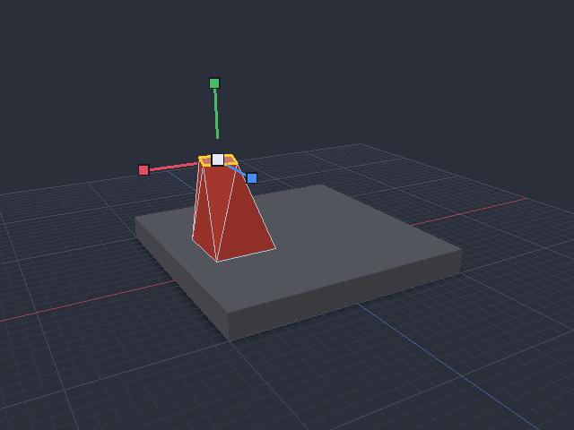 |

**Edge mode** (step 4): the edge along the top of the window's wall
picked, with the arrows that move it, and its name and length in the
panel.

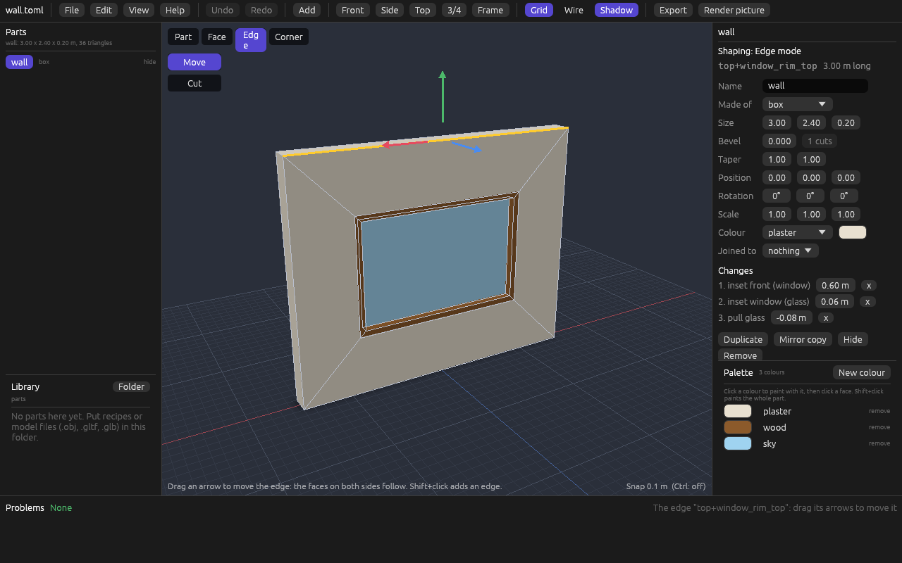

**The Cut tool** (step 4), on the chair: the ring shows where the cut
would go, all the way round, and the label says which way and where.

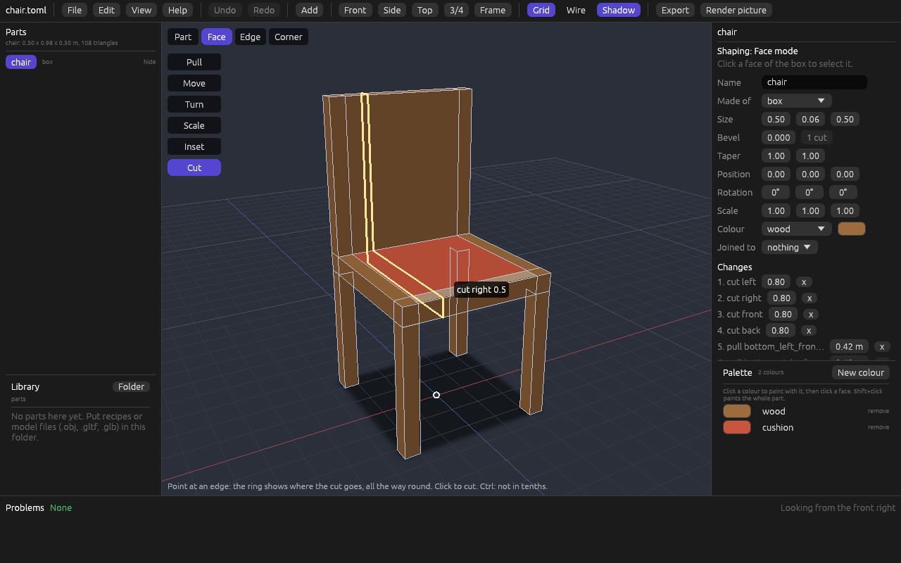

**Corner mode** (step 5), on the rock: its 26 corners as dots, one
picked, with its name and where it is in the panel.

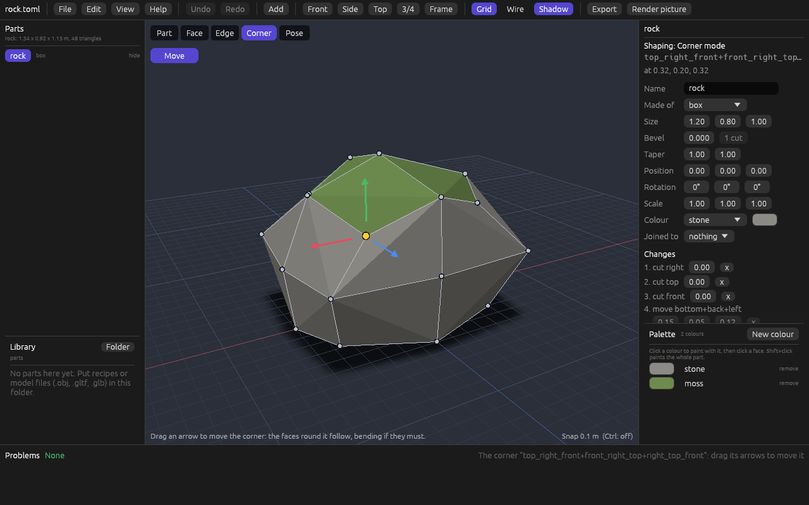

**Using a shaped part again** (step 7): the part's menu has "Make a
definition..." and "Save to the library"; the first asks for a name;
the second puts the chair in the library at once, with its picture.

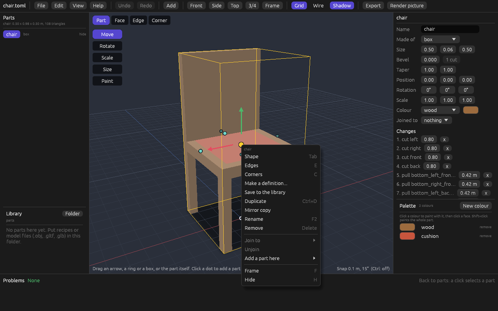

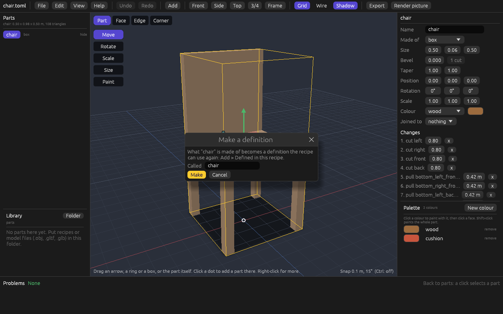

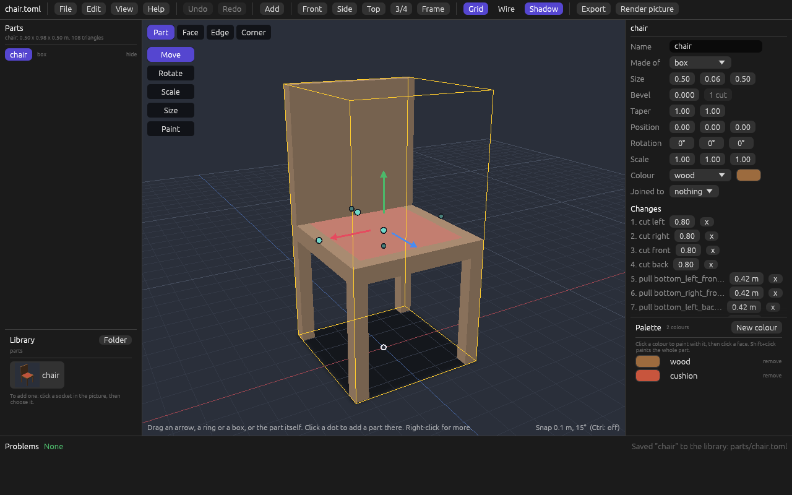

**The Add menu with pictures** (step 8), from the top bar and from a
socket's dot:

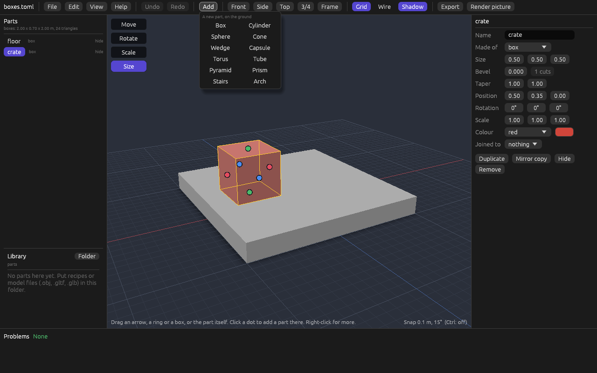

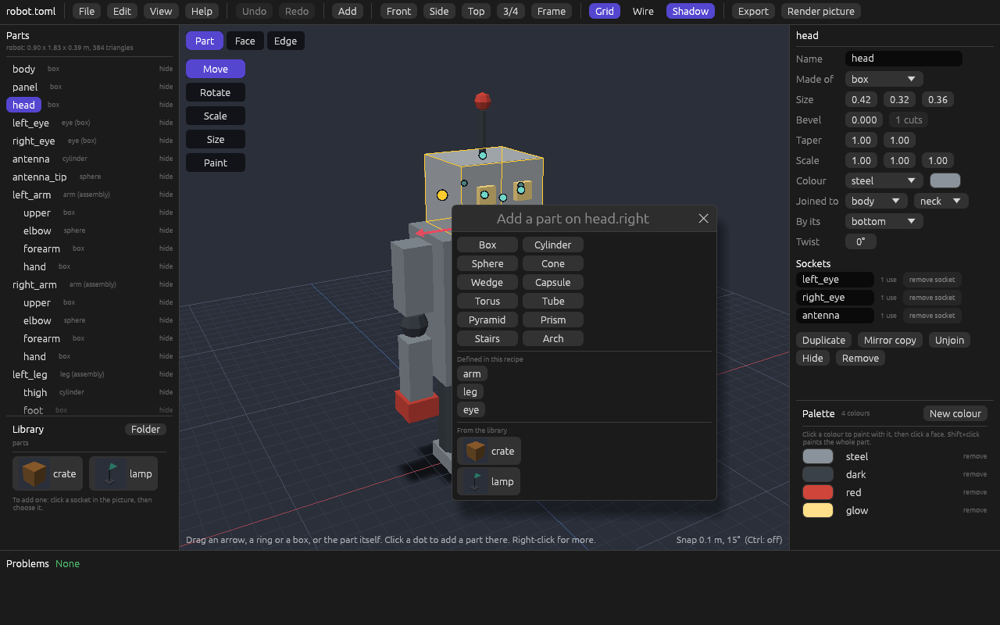

**A socket's facing** (step 8): each socket in the panel has a list,
`out` (as before), `up`, `down`, `left`, `right`, `front`, `back`.

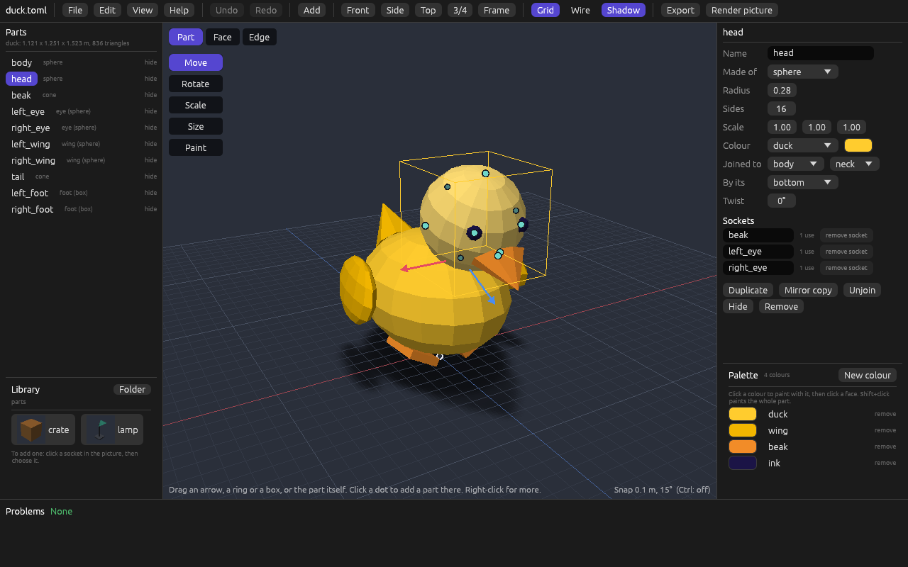

**The new examples** (step 9), as the start page shows them:

| chair | window_wall | rock | house |
|---|---|---|---|
| 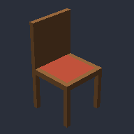 | 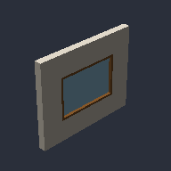 | 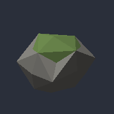 | 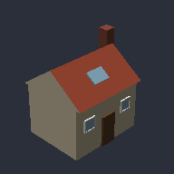 |

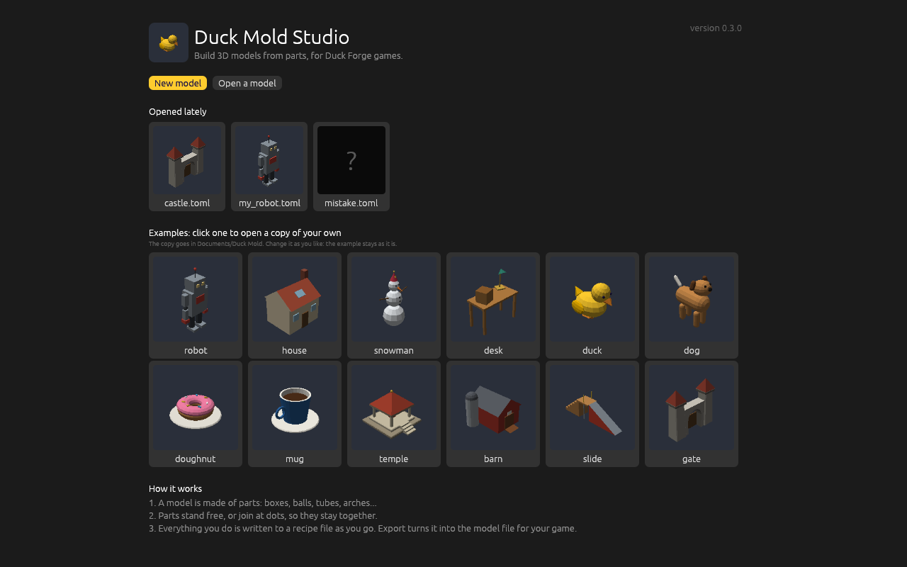

## What works

### 1. Changes in the recipe, and `inspect`

- A box (without a bevel) can have `changes`: `pull`, `inset`, `move`,
  `turn`, `scale` and `cut`, done in order, in the box's own
  measurements, before its `scale`, `rotate` and `move`. A part made
  with `use` is shaped in its definition.
- Faces are named as the design says: a pull keeps the face's name on
  its end and names its walls `<face>_side_<word>` (or `<name>_<word>`);
  an inset leaves the name on the ring and names the middle
  `<face>_inset` (or its `name`) and the ring's pieces
  `<middle>_rim_<word>`; a cut names the slice by the side. A name can
  stand for several faces (`backrest` is all the backrest's walls). A
  taken name gets a number.
- After every change, five checks: every face has room, the shape holds
  room inside it, no two corners are in one place, no face passes
  through another, and every edge is shared by exactly two faces. The
  first change that fails is the mistake, with its place in the file
  and the face it was about.
- `inspect` says how many changes a part has; `inspect --faces` lists
  every face of every shaped part, which way it faces, its size and
  the faces next to it. `--json` has the same.

### 2. Face mode

Tab (or the Face button) shapes the selected box. A click selects a
face, Shift+click adds one. T is the Pull arrow, I the Inset knob.
Drags snap in steps (Ctrl: free), show what they would do as they go,
and are one step to undo. The panel lists the changes, each with its
amounts, which can be typed or dragged, and an x to take it away.

### 3. Slide, turn and scale a face

G, R and S, with the same arrows, rings and boxes as for parts. The
faces round a moved face stretch to follow.

### 4. Edges, and the cut

E shows the edges; a click picks one by name (`top+front`), and its
arrows move it. K, in Face or Edge mode, is the Cut tool: a ring shows
where the cut goes, across the face under the pointer, in tenths
(Ctrl: free); a click cuts.

### 5. Corners

C shows the corners as dots; a click picks one by name
(`top+front+left`), and its arrows move it. A four-sided face that
bends is drawn as two triangles, folded the way that bulges out.

### 6. New faces are painted and carry sockets

`colors = { glass = "sky" }` paints a new face like an old one, and the
Paint tool does it with a click. `lamp = { on = "window_rim_top" }` is
a socket at the middle of that face, facing out of it, and it moves
with the face. A click on a new face in Part mode makes such a socket,
so a part can be added there.

### 7. A shaped part used again

"Make a definition..." moves what the part is made of (shape, sizes,
changes, colours, its own sockets) to `[define.<name>]`, as it was
written, and the part becomes `use = "<name>"`; the model is the same,
face for face. "Save to the library" writes `parts/<name>.toml`: the
part alone, with the colours it uses. The commands: `define` and
`duck-mold save-part`.

### 8. Leftovers and three fixes

- **Pictures in the Add menu**: each of the twelve shapes, drawn from a
  recipe of the shape alone by the same code as `render`, stored, and
  checked by a test like the examples' pictures.
- **A facing choice for sockets**, in the panel, and
  `set-socket --facing`.
- **Hidden parts are remembered** for each of the models opened lately,
  in the Studio's settings beside that list, and hidden again when the
  file is opened (the status line says so). The recipe knows nothing
  of it.
- **A copy of a joined part** goes to the next socket of the same part
  that nothing is joined to and that faces the same way (the next table
  leg's socket); else to a new socket made beside the original, 10 cm
  past it; else it stands free in front of the model. The status line
  says which.
- **`duck-mold edit add` with no place** walks from the middle of the
  model towards its front until the new part is clear of the others,
  in the edit itself. The Studio's Add menu uses the same walk,
  towards the camera.
- **A part standing on the ground no longer "floats"**, nor anything
  touching it. Only a part up in the air that touches nothing does.
  No example's report changed.

### 9. Examples

`chair.toml`, `window_wall.toml` and `rock.toml` are new, each with its
stored model, report and picture, and on the start page.
`house.toml`'s windows are one `[define.window]`, its front inset to a
frame and a pane and the pane pushed back; its stored files changed on
purpose, and no other example's changed by one byte.

## Every new action is an edit command

All are in the agent guide (`docs/AI_GUIDE.md`). A test fails if an
edit exists without a command and a line in the guide.

| Command | What it does | Step |
|---|---|---|
| `pull <part> <faces> --by <m>` | Pulls faces out (or in), with walls round them. `--name`. | 1 |
| `inset <part> <faces> --by <m>` | Insets faces, leaving a ring. `--name`. | 1 |
| `set-change <part> <n>` | Changes the amount of change n: `--by`, `--by x,y,z`, `--at`. | 2 |
| `remove-change <part> <n>` / `--all` | Takes a change away. | 2 |
| `move-face <part> <faces> --by x,y,z` | Slides faces. | 3 |
| `turn-face <part> <faces> --by x,y,z` | Turns faces about their middle, in degrees. | 3 |
| `scale-face <part> <faces> --by n` or `x,y,z` | Makes faces bigger or smaller. | 3 |
| `move-edge <part> <edges> --by x,y,z` | Moves edges (`top+front`). | 4 |
| `cut <part> --toward <side> --at <0..1>` | Cuts all the way round. `--name`. | 4 |
| `move-corner <part> <corners> --by x,y,z` | Moves corners (`top+front+left`). | 5 |
| `add-socket <part> <name> --on <face>` | A socket on a new face, by its name. | 6 |
| `define <part> <name>` | Makes what a part is made of a definition. | 7 |
| `duck-mold save-part <recipe> <part> <file>` | Writes the part alone as a recipe. Never writes over a file. | 7 |
| `set-socket <part.socket> --facing <way>` | Turns a socket; `out` takes `facing` away. | 8 |
| `duck-mold inspect --faces` | Lists every face of every shaped part. | 1 |

A move, turn or scale of the same faces, edges or corners as the last
change is put together with it (moves and turns add up, scales
multiply), rather than written as a second change; back to nothing,
the change goes. Selecting
faces, edges and corners, the modes and the tools change nothing in the
file, so they have no command. Remembering hidden parts is the same.

## Tests

510 tests, all passing, with `cargo fmt` and `cargo clippy` clean. CI
runs them on Windows and Linux; every step's run is green so far (see
below for the last).

| Where | Tests | What they cover |
|---|---|---|
| The library | 341 | Recipes, shapes, sockets, colours, edits, model files. Shaping: every change, every name rule, every check and its message, and 2000 random lists of changes (pulls, insets, moves, turns, scales, cuts, edges, corners) on random boxes, each result checked to be closed, facing outwards and not passing through itself by code written apart from the shaping code. More seeds can be tried with `DUCK_MOLD_SEED`. The shaped examples are checked the same way. |
| The command line | 39 | Every command, the exit codes, and the stored model, report and picture of all eighteen examples, compared byte for byte. |
| The Studio with no screen | 84 | Face, Edge and Corner mode driven by pointer positions: every tool, snapping, refused drags, cuts, one undo per drag. 21 stored pictures of the viewport. |
| The Studio's real screen | 46 | Clicks, drags, keys (Tab, E, C, T, G, R, S, I, K), the menus, the panel's changes and sockets, the definition window, the library, remembered hidden parts. 38 stored pictures of whole screens. The examples' and the shapes' pictures are checked against their recipes. |

## Known limits

- **Nobody has shaped anything on real Windows yet.** The tests drive
  the real screen code, but whether the arrows and knobs feel right
  under a hand is for you to say.
- **Only a box can be shaped**, and not a bevelled one. A cylinder or a
  sphere can't. (The design chose this; it is enough for the chair,
  the wall, the rock and the windows.)
- **A cut is measured on the box as it was made**, from its middle to
  its side. So a cut can't reach a part that was pulled out past the
  box: the chair's back can't be cut across.
- **Names after cuts get long.** The rock's corners are called things
  like `top_right_front+front_right_top+right_top_front`. They are
  exact and they stay put, but nobody would type them; the Studio
  picks them by a click, and the panel cuts them short with the whole
  name in the tip.
- **Inset of several faces** insets each face on its own, rather than
  the faces as one region with one ring round it.
- **Two faces that touch only at a corner can't be pulled together**:
  the result would touch itself, and it is refused, naming the change.
- **The Cut tool's ring is drawn through the model**, also where the
  model hides it.
- **`define` works on a part in the model's own list**, made from a
  shape or a file. A part inside another part, or one made of parts,
  is refused with a message. Comments inside a moved list (`changes`)
  move with it, but a comment at the end of a moved field's line is
  lost, and a comment on the line above a moved field stays behind in
  the part.
- **A copy's place beside the original** is found with the boxes round
  the parts, not their exact shapes, so it can leave a little more room
  than needed. A copy that can't go beside stands free in front of the
  model, even if the original was high up on it.
- **`add-socket` has no `--facing`**: add the socket, then
  `set-socket --facing`.
- **Hidden parts are remembered** for the eight models opened lately.
- **"Save to the library" writes a file and changes no recipe**, so
  Undo doesn't take it away: delete `parts/<name>.toml` by hand if it
  isn't wanted.
- **The program is still unsigned**, so Windows asks "More info, Run
  anyway" the first time.

## What changed from the design

Steps 8 and 9 are also in `DESIGN.md` section 20, under "As built".

- **A fifth check**: no two corners in one place. 2000 random lists
  found a pull of two faces touching only at a corner that left the
  shape touching itself, which the other four checks let through. It
  is now refused.
- **The message for a shape passing through itself** names both faces:
  `pulling "glass" in by 0.3 makes "glass_side_bottom_2" pass through
  "back"`.
- **The chair is 108 triangles**, not the 118 the design guessed.
- **`define` is limited** to parts of the model's own list made from a
  shape or a file (above).
- **Inset of several faces** is face by face (above).
- **A copy of a joined part** only goes to a free socket that faces the
  same way as its own, so a leg doesn't land on a socket meant for a
  lamp. With no room beside, it stands in front of the model (the way
  `add` walks), not beside it.
- **The socket list** shows plain words (`out`, `up`...), and "x"
  removes a socket, so the panel keeps its width.
- **The Add menu** has its shapes in three columns, with pictures, so
  the list stays short enough to show the library under it.
- **Hidden parts** are kept in `hidden.txt` beside `recent.txt`.
- **Long names** in the panel (a corner's, an edge's, a change of one)
  go on a line of their own, cut short, with the whole name in the tip.
- **The house's windows** became one definition used twice, rather
  than two shaped parts written out twice.

## What Phase 5 (bones and animation) should start with

What is there to build on:

- A model is already a tree of rigid parts joined at sockets, and every
  join knows its pivot: the socket, with the way it faces, and a
  `twist` about it. That is most of a skeleton already.
- Every part, shaped or not, is closed, faces outwards and has named
  faces, so it can be moved whole without anything breaking.
- `inspect` already finds parts that float or overlap; it can be asked
  the same of a pose.

What I would do first, in this order:

1. **Decide what a bone is in the recipe.** My suggestion: a bone is a
   join. `left_arm` hangs from `body.left_arm`, so turning that join
   turns the arm and everything hanging from it. No new objects to
   place, and every model made so far can already be posed. A part
   that should bend (rather than turn whole) is for later, if ever:
   that is skinning, and it is a much bigger job.
2. **Change the `.glb` first, with Duck Forge.** Today the model is one
   mesh, and a part is a range of its triangles. To animate it, each
   part needs to be a node with its pivot, in a tree that follows the
   joins, and Duck Forge's reader needs to read that and play glTF
   animations. This touches both repositories and the reader's
   version, so it should be settled and tested before anything else.
3. **Poses in the recipe**, as words: `[poses.wave]` with a turn for
   each join that moves (`left_arm = [0, 0, -60]`), within limits a
   join can say. `render --pose wave` and `inspect --pose wave` let an
   agent check a pose for floating and overlapping parts.
4. **Animations as poses in time**: `[animations.walk]` with a list of
   poses and when each is reached, smoothed between. `render` can draw
   a strip of frames.
5. **A Pose mode in the Studio**, like Face mode: click a part, drag a
   ring at its join, and the pose in the recipe changes; a timeline to
   pick which pose is shown. Every action an edit command, as now.

Small things left from this phase, if you want them first: an
`add-socket --facing`; a Cut ring hidden where the model covers it;
inset of several faces as one region.
