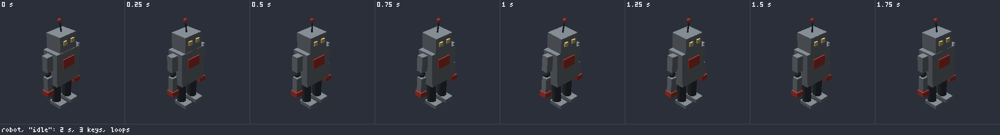
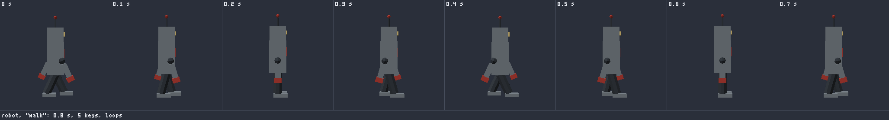
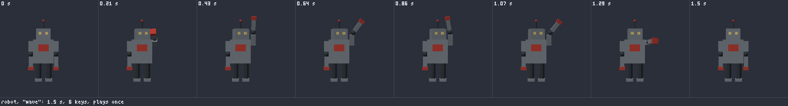
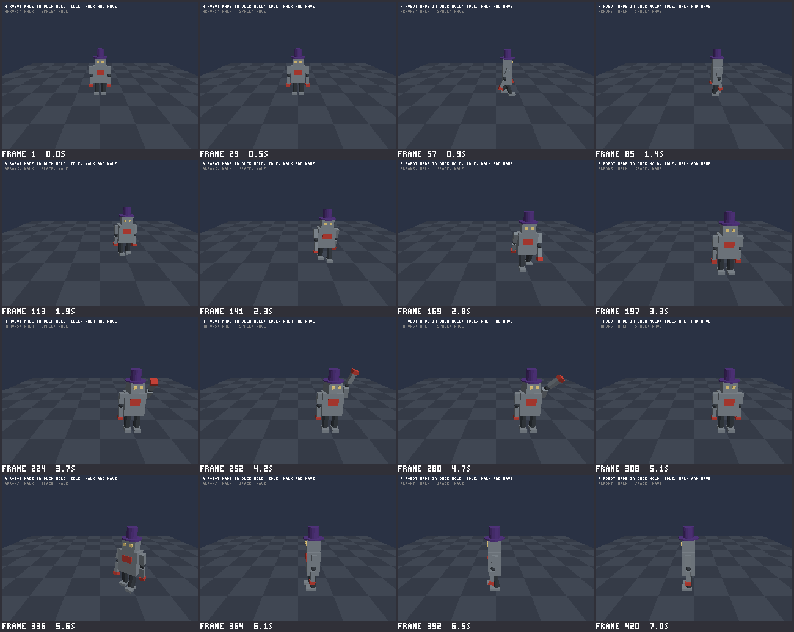

# Duck Mold: Phase 5a report

Phase 5 is "Motion", designed in `DESIGN.md` section 21 and approved
with all fifteen decisions as recommended, one of which was to split it
in two. **This is the first half, 5a: steps 1 to 5.** Models can now
move, and a Duck Forge game can play them. The second half, 5b (steps 6
to 9), is posing with the mouse in the Studio, a timeline, the
animation library with its starters, and more examples. The full
`PHASE5_REPORT.md` comes at the end of 5b.

The work is on the branch `claude/duck-mold-phase-5`, made from `main`,
one commit for each step. No pull request has been opened in Duck Mold:
say so when you want one. Two are open in Duck Forge, as the steps
asked (below).

The four rules still hold. The recipe is the model. Every action is an
edit command an agent can run too. An edit changes only what it has to
in the file. Pictures are drawn by Duck Forge's CPU renderer.

## In short

A model moves by turning its parts about the sockets they are joined
to. There are no bones to build: the joins are the bones. Everything is
written in the recipe, in words:

```toml
[[parts]]
name = "head"
limits = { x = [-30, 30], y = [-80, 80] }   # how far it may turn

[poses.step_left]                            # a pose: which parts are turned, in degrees
left_leg = [25, 0, 0]
right_leg = [-25, 0, 0]

[animations.walk]                            # an animation: poses, each reached at a time
loop = true
keys = [
  { at = 0, pose = "step_left" },
  { at = 0.4, pose = "step_right" },
  { at = 0.8, pose = "step_left" },
]
```

`duck-mold export` puts the animations in the `.glb`, and a Duck Forge
game plays them by name:

```rust
let mut robot = AnimatedModel::load("assets/robot.glb")?;
if walking { robot.play("walk") } else { robot.play("idle") }
robot.update(ctx.dt());
canvas.draw_mesh(robot.mesh(), &Transform::at(position), &camera);
```

The robot example now stands idle, walks and waves.

## The robot's three animations

Each strip is what `duck-mold render examples/robot.toml --animation
<name>` draws: eight frames, evenly spaced in time, from one place.
These three files are stored in `tests/golden/` and checked on every
run.

**idle** (2 seconds, loops): the arms come a little away from the body,
the head lifts, the antenna sways.



**walk** (0.8 seconds, loops), from the side: legs and arms swing
against each other, the feet stay flat, and the body sinks 4 cm at each
step.



**wave** (1.5 seconds, plays once), from the front: the arm goes up
beside the head and the forearm tips out and in, twice.



And the same robot in a Duck Forge game (`examples/robot_walk/` in Duck
Forge): standing, walking to the right, walking towards you, waving,
and walking off to the left. Its hat isn't part of the model: the game
puts it on the socket `head.top`, and it stays on.



## What works

**Step 1: the `.glb` as a tree of parts.** The file now holds one
object for every part, at the join it turns about, hanging from the
part it is joined to. Models without animations load and look exactly
as before, and files exported earlier still load. (Reported in more
detail when it was built: `DESIGN.md`, "As built (step 1)".)

**Step 2: limits.** A part can say how far it turns: `limits = { x =
[-30, 30], y = "free" }`, `"fixed"`, or nothing (it turns freely).
`duck-mold edit ... set-limits`, and `duck-mold inspect --joins` lists
the tree the model moves by.

**Step 3: poses.** `[poses.wave]` with a line for each part that isn't
at rest: its turn in degrees, or `{ turn = ..., move = ... }`. What
hangs from a part goes with it. `rest` is always a pose.

- Edit commands: `set-pose`, `add-pose` (`--from` copies one),
  `rename-pose`, `remove-pose`, `mirror-pose` (left to right).
- `inspect --pose wave` reports on the model as the pose puts it: its
  size, what floats or overlaps that doesn't at rest, and limits the
  pose breaks. `render --pose wave` draws it.
- Renaming a part renames its lines in every pose; removing a part
  removes them.
- A turn past a part's limits is a warning, not an error: the model
  still builds.

**Step 4: animations.** `[animations.walk]` with `keys` (a pose and a
time), `loop` and `smooth`.

- Between two keys every number goes from one pose's to the next's, so
  a wheel from 0 to 360 turns once round. With `smooth` (the default)
  the motion flows through the poses, stops where a part turns back,
  and starts and ends gently; it never goes past a pose on the way to
  it, so poses inside the limits keep the whole animation inside them.
- Edit commands: `add-animation`, `set-animation` (`--loop`,
  `--smooth`, `--length`), `rename-animation`, `remove-animation`,
  `add-key`, `move-key`, `set-key`, `remove-key`. Renaming a pose
  renames it in every key; a pose that keys use can't be removed from
  under them without `--with-keys`.
- `inspect --animation walk` looks at every frame, thirty a second,
  and says the worst it finds and when: how far the lowest point leaves
  the ground, parts that float or overlap, limits broken, and whether a
  loop ends as it starts.
- `render --animation walk` draws the strips above (`--frames` for how
  many, `--view` for where from).
- A loop that doesn't end on the pose it starts with is a warning.

**Step 5: in the file, and in a game.**

- `export` writes each animation as a standard glTF animation (thirty
  samples a second), and each named pose. The official glTF validator
  reports no errors, warnings, infos or hints on any of the eighteen
  stored models. Other glTF programs can play the file too.
- Duck Forge's `AnimatedModel`: `play`, `play_once`, `play_looping`,
  `restart`, `stop`, `resume`, `rest`, `set_pose`, `set_speed`
  (negative plays backwards), `turn` and `release` (game code turns one
  join itself), `update`, `mesh`, `socket` (where a socket is now),
  `is_playing`, `finished`, `playing`. Changing animation blends over
  0.15 seconds. A wrong name doesn't stop a game: nothing changes, and
  it is said once on the terminal.
- Duck Forge's example `robot_walk`: arrow keys walk the robot about,
  Space makes it wave.

Every new action has a line in the agent guide (`docs/AI_GUIDE.md`,
section 11, "Models that move", and the edit table), and a test checks
that every edit command is there.

## The two Duck Forge pull requests

| | What | State |
|---|---|---|
| [Duck-Forge#11](https://github.com/mrguymrguy647-del/Duck-Forge/pull/11) | Step 1: the reader, version 4, for files laid out as a tree. | Open. |
| [Duck-Forge#12](https://github.com/mrguymrguy647-del/Duck-Forge/pull/12) | Step 5: the reader, version 5, `AnimatedModel`, the `robot_walk` example. It sits on top of the first: merge the first, then this one. | Open. |

Duck Mold is pinned to the Duck Forge commit of the second one, and one
of Duck Mold's tests plays the robot's animations through it.

The loaders are in step, as before: the reader is the same code in both
repositories (between the two marker lines, byte for byte; the command
in `docs/forge-handoff.md` that compares them prints nothing), its
version went from 3 to 5, both repositories test with the same robot
file, and the handoff note is updated.

## How it was checked

| | |
|---|---|
| Duck Mold's tests | 570 pass, none fail (it was 510 at the end of Phase 4). `cargo fmt` and `cargo clippy` are clean. |
| Duck Forge's tests | 671 pass with everything on, 636 without a window; none fail. `fmt` and `clippy` clean. |
| Duck Mold against Duck Forge's reader | Duck Mold poses a test model its own way and the reader poses it from the file: every corner of every part is in the same place, to a few millionths of a metre, in every pose and at every sample of every animation. |
| Duck Forge playing the robot | Every animation is played frame by frame and checked against Duck Mold's report on it; fourteen stored pictures are compared pixel for pixel; the example has six tests and a recorded playthrough. |
| Golden files | The robot's model, report, and a strip and a report for each of its three animations. The other seventeen examples' files didn't change after step 1. |
| The robot's file | 50 KB in Phase 4, 64 KB as a tree, 78 KB with three animations and six poses. |
| One frame of the robot in a game | About 2.5 millionths of a second to work out. |

How the checks on GitHub ended (Windows and Linux, both repositories)
is at the end of this report.

## Known limits

- **The Studio doesn't know about motion yet.** It opens a model with
  poses and animations and shows it standing still; its edits keep the
  poses right (they are the same edit commands). Posing with the mouse
  and a timeline are 5b. The properties panel doesn't show a part's
  limits yet.
- **No reaching (IK)**, as designed. A foot isn't put on the ground:
  the leg is turned and the body moved until it touches. The robot's
  walk keeps its feet within 3 mm of the ground; `inspect --animation`
  says so.
- **Parts are rigid.** Nothing bends, so where a leg swings its top
  pokes a little into the body (up to 4 cm on the robot).
  `inspect --animation` lists each such overlap and when.
- **The file holds samples, thirty a second, with straight steps
  between.** Where a motion starts from a stop, the straight step is up
  to about a degree off the smooth curve, for a thirtieth of a second.
  You won't see it; it is why Duck Mold's picture of a frame and Duck
  Forge's can differ by a hair between samples. A part can't turn more
  than half round between two samples: 15 turns a second.
- **An animation doesn't move the model along the ground.** The game
  does. If the game's speed doesn't match the steps, the feet slide:
  the robot's walk fits 1 metre a second.
- **In Duck Forge, a join the game turns itself replaces the
  animation's turn** for that join; it isn't added to it. And `turn`
  doesn't know the recipe's limits.
- **A recipe used as a part inside another** brings its limits, not its
  poses and animations (as designed).
- **`duck-mold inspect robot.glb`** reports on the model in the file,
  not its animations. Inspect the recipe for those.
- **`mirror-pose` goes by names**: `left_arm` and `right_arm` swap. A
  model whose two sides aren't named `left` and `right` isn't mirrored
  by it.
- **Duck Forge's older example, `turntable`,** keeps the robot file it
  had; it still loads.

## What changed from the design

- **Smooth never overshoots.** The design said the motion "flows
  through each pose". As built it also never goes past a pose on its
  way to it, so that poses within the limits can't make an animation
  that breaks them.
- **An animation can be empty.** `add-animation` makes one with no
  keys (a warning until it gets one). The edit commands keep the first
  key at 0: `move-key` won't move key 1, and removing key 1 moves the
  others earlier.
- **`inspect --animation` has a report of its own**, not the model's
  report with lines added.
- **The strip is `robot.walk.strip.png`**, not `robot.walk.png`,
  because a pose and an animation may share a name (the robot's
  `wave`). Each frame's time is in its corner. `--view` was added: a
  walk shows best from the side.
- **The format's number in the file stays 1.** Animations are added
  beside the model, so a Duck Forge with the first pull request only
  still loads a file that has them, as a model standing still. The
  reader's version is 5.
- **A part says which directions its turns are measured in**, where
  they aren't the model's own, so game code can turn a join by degrees
  and get what a pose gets (a mirrored arm bends as a mirror image).
- **`AnimatedModel` gained `restart()`**, because `play` of what is
  already playing changes nothing; and `time()`, `mesh_mut()` and
  `model()`.
- **The reader is in two halves.** Where an animation puts every part
  is in the shared reader, so Duck Mold's tests can check it; what is
  playing is Duck Forge's own.
- **`remove-pose --with-keys`** arrived with animations (step 4), not
  with poses (step 3).
- **Found on the way:** a recipe with a comment that stands apart over
  what comes next (`# ---- how it moves ----`) used to get a new part
  put under that comment, and a copy of the last part copied it. Now a
  new part, a copy or a new pose goes above such a comment, and
  removing one leaves it.
- **The version number isn't in any picture**, so going to 0.5.0
  changed no stored picture (the design expected the start page's to
  change).

## What 5b starts with

1. **Step 6, Pose mode in the Studio**: click a part and turn it with
   rings that stop at its limits; the pose list; "Mirror". Every drag
   is a `set-pose`.
2. **Step 7, the timeline**: keys as dots to drag, play and stop, loop
   and smooth as switches. Every change is one of the key commands.
3. **Step 8, the animation library**: `save-animation`,
   `add-animation --from`, and the starters (`idle`, `walk`, `wave`,
   `jump` for two legs; `open` for a door; `roll` for wheels), by the
   names `body`, `head`, `left_arm`, `right_arm`, `left_leg`,
   `right_leg`.
4. **Step 9, examples**: a door that opens, a cart whose wheels turn,
   and a second character that takes the robot's walk; the robot gets
   `jump`. Duck Forge tests play each.
5. Small things from this half: show a part's limits in the Studio's
   properties panel; a button to see an animation play in the Studio's
   own view.

The first thing to do in 5b, before any of it: merge the two Duck Forge
pull requests, and move Duck Mold's pin to Duck Forge's `main`.

## To try it

The Windows zip is built by the Release workflow for this branch (the
link is at the end of this report). Unzip it and:

- Double-click `DuckMoldStudio.exe` and open the robot: it stands
  still (see the first known limit).
- In a Command Prompt in that folder:

```bat
duck-mold inspect examples\robot.toml
duck-mold inspect examples\robot.toml --animation walk
duck-mold render examples\robot.toml --animation walk --view right
duck-mold edit examples\robot.toml set-pose wave left_arm --turn 150,0,0
duck-mold render examples\robot.toml --animation wave --view front
```

To see it move, in a Duck Forge folder on the branch
`claude/duck-mold-motion`:

```bash
cargo run --example robot_walk
```

## The checks on GitHub

As this report was first written:

| | |
|---|---|
| Duck Mold, steps 1 to 4 | Green on Windows and Linux, each step's own run. |
| Duck Mold, step 5 and version 0.5.0 | Running. |
| Duck Forge, the first pull request | Green (Duck Forge's checks run on Windows; its Linux numbers above are from the build machine). |
| Duck Forge, the second pull request | Running. |
| The Windows zip | Being built by [this Release run](https://github.com/mrguymrguy647-del/Duck-Mold/actions/runs/43577483559): when it has finished, the zip is under "Artifacts" at the bottom of that page. |

This section is brought up to date when they finish.
