# Duck Mold: Phase 5 report

Phase 5 is "Motion", designed in `DESIGN.md` section 21 and approved
with all fifteen decisions as recommended. It was built in two halves.
`PHASE5A_REPORT.md` covers the first half, steps 1 to 5, in detail.
This report covers the whole phase, and the second half (5b, steps 6
to 9) most of all.

- **5a**: models move, and a Duck Forge game plays them.
- **5b**: posing with the mouse, a timeline, an animation library with
  six starters, and four examples that move.

Where the work is:

- **5a** was merged into `main` through
  [Duck-Mold#7](https://github.com/mrguymrguy647-del/Duck-Mold/pull/7).
- **5b** is on the branch `claude/duck-mold-phase-5b`, made from that
  `main`, with one commit for each step. I haven't opened a pull
  request for it: say when you want one.
- **Duck Forge**: its two 5a pull requests are merged, and Duck Mold is
  pinned to Duck Forge's `main`. One new pull request is open for 5b:
  [Duck-Forge#13](https://github.com/mrguymrguy647-del/Duck-Forge/pull/13).

The four rules still hold:

- The recipe is the model.
- Every action in the Studio is an edit command that an agent can run
  too.
- An edit changes only what it has to in the file.
- Pictures are drawn by Duck Forge's CPU renderer.

## In short

A model moves by turning its parts about the sockets they are joined
to. The joins are the bones: there is nothing else to build. It is all
written in the recipe:

- **limits**: how far a part may turn;
- **poses**: which parts are turned, and by how much;
- **animations**: poses, each reached at a time.

`export` puts the animations in the `.glb`. A Duck Forge game plays them
by name, with `robot.play("walk")`.

What 5b adds:

- **Pose mode** (O): the model stands in one of its poses. Click a part
  and drag its rings to turn it. The rings stop at the part's limits.
- **The timeline**: an animation's keys, shown as diamonds along the
  bottom of the window.
- **A Play button** in the view, for any mode.
- **The animation library.** A walk made on one model is saved to a
  file and copied into another. Six starters come with the program.
- **Four examples that move**:
  - the robot, which now also jumps;
  - a door that opens;
  - a cart whose wheels roll;
  - a gnome that walks with the robot's walk.

## The new screens

**Pose mode.** The robot is in its `wave` pose with the left arm
selected. The rings are drawn at the shoulder, one for each direction
its limits let it turn. A drag snaps to 5 degrees (hold Ctrl for no
snapping) and stops at the limit.

The panel on the right has:

- the pose list, with New, Copy, Mirror, Rename and Remove;
- the arm's turn and move, as numbers to type;
- Back to rest;
- its limits, which you can change.

In the list of parts, the parts this pose turns are marked with a
yellow `*`.

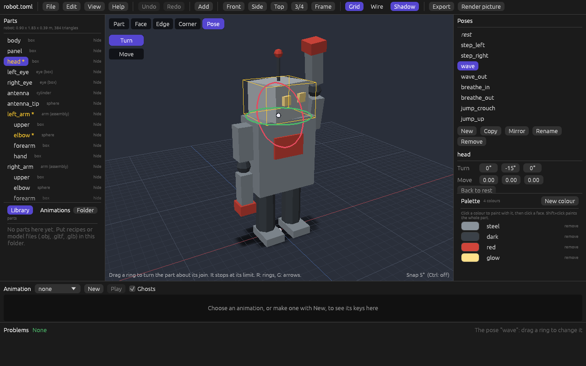

**A fixed part has no rings.** The line under the picture says why.

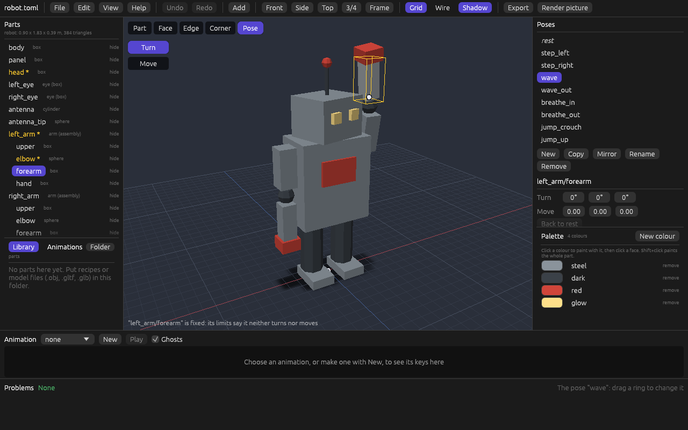

**The timeline.** This is the robot's `wave`, half way between two
keys:

- Each key is a diamond, with its pose's name.
- The faint blue outline is the key before, and the orange one is the
  key after.
- Drag a key to change its time. Right-click a key to remove it or give
  it another pose.
- Drag along the ruler to move through time.
- **+ Key** adds the pose chosen, at the time shown.
- Loop and Smooth are the animation's own settings.
- Turning a part between two keys makes a new pose there, with a key.

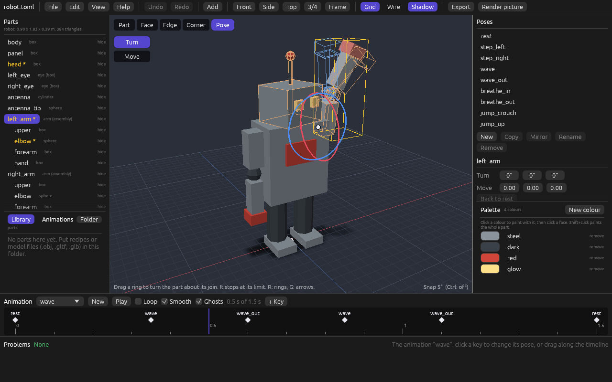

**Play in the view.** The button is in the top right corner of the
view, in Part mode, with a list to pick the animation. This is the
robot part way through its wave. Space plays and stops it in any mode.

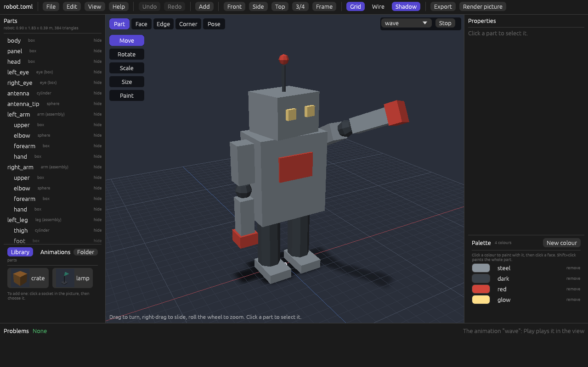

**The animation library.** Under the list of parts, the panel now
switches between Library (parts) and Animations:

- It lists the six starters, then the animations saved in `animations/`
  beside the recipe.
- **Add** copies one in, with its poses, and picks it for the timeline.
  It is greyed out, with the reason, when the model has none of the
  parts it moves. The robot has no `door` and no wheels.
- **Save** writes one of the model's own animations to `animations/`.

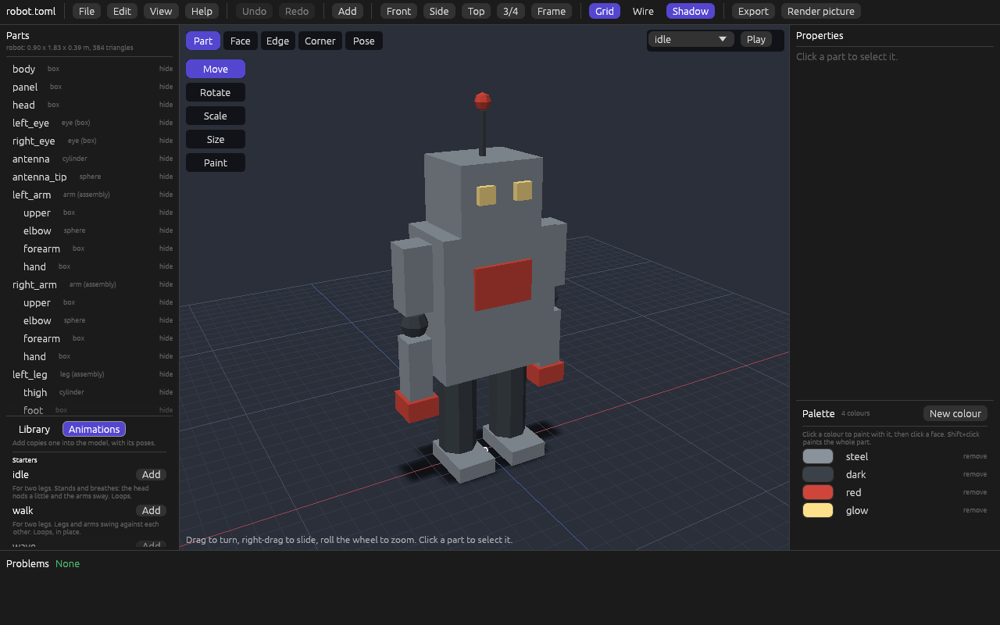

**A part's limits in Part mode.** The properties panel has a folded
**Limits** section in every mode (open in Pose mode, as above). It
holds the same settings as `set-limits`. A window test opens it,
changes a limit and checks the recipe.

**The start page** has 18 examples now. The three new ones are on the
bottom row.

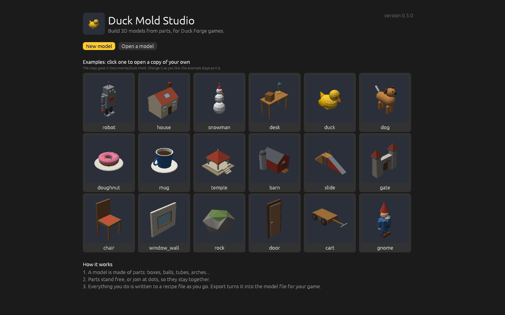

## The examples' animations

Each strip below is drawn by `duck-mold render <recipe> --animation
<name>`: eight frames, evenly spaced in time, all from the same place.
Every strip, and a report on every animation, is stored in
`tests/golden/` and checked on every test run.

**robot: idle** (2 s, loops). The arms sway and the head lifts.

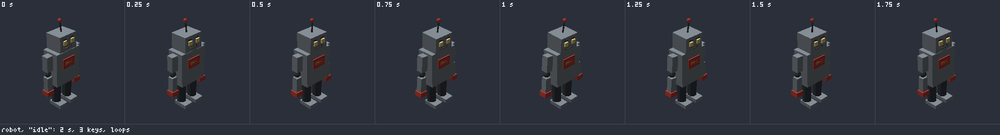

**robot: walk** (0.8 s, loops), from the side. The feet stay flat.

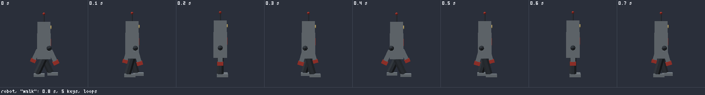

**robot: wave** (1.5 s, plays once), from the front.

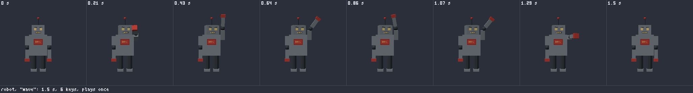

**robot: jump** (1.3 s, plays once, new), from the side. It crouches
with its arms back, rises 39 cm with its arms up, lands and
straightens. It is the starter `jump`, fitted to the robot:

- its feet turn back as its legs turn, so they stay flat;
- its body sinks 2.5 cm in the crouch, so the feet dig in no more than
  4 mm.

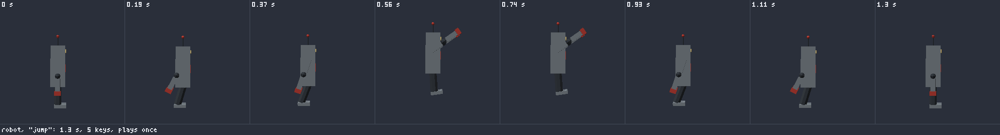

**door: open** (1 s, plays once, new), from straight above, with the
front at the bottom. The handle turns down first, then the door swings
90 degrees towards you. Played backwards in a game, it closes.

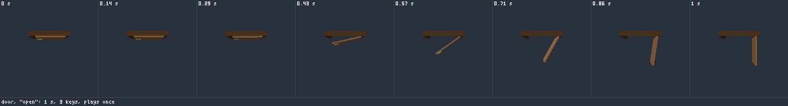

**cart: roll** (1 s, loops, new), from the side. Each wheel turns once,
at a steady speed, rolling the cart forward. It has one spoke so you
can see it turn: a bar right across would look the same after half a
turn.

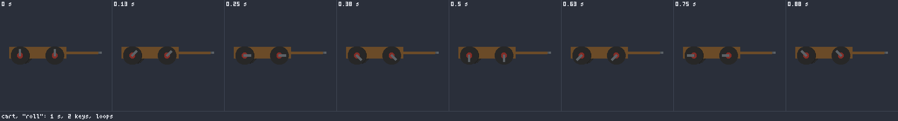

**gnome: walk** (0.8 s, loops, new). This is the robot's own walk:

1. It was saved to `examples/animations/walk.toml`.
2. It was copied into the gnome with `add-animation --from`.
3. It was fitted to the gnome's shorter legs: each step sinks the body
   1.7 cm, not the robot's 4.

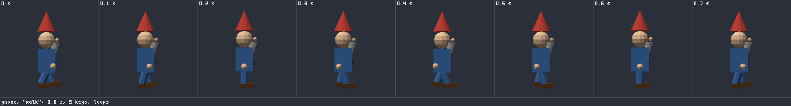

**gnome: wave** (1.8 s, plays once, new). This is the starter `wave`,
just as it comes.

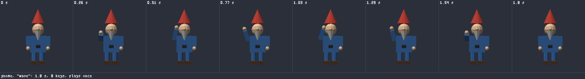

The robot in a Duck Forge game (Duck Forge's `examples/robot_walk/`,
from 5a):

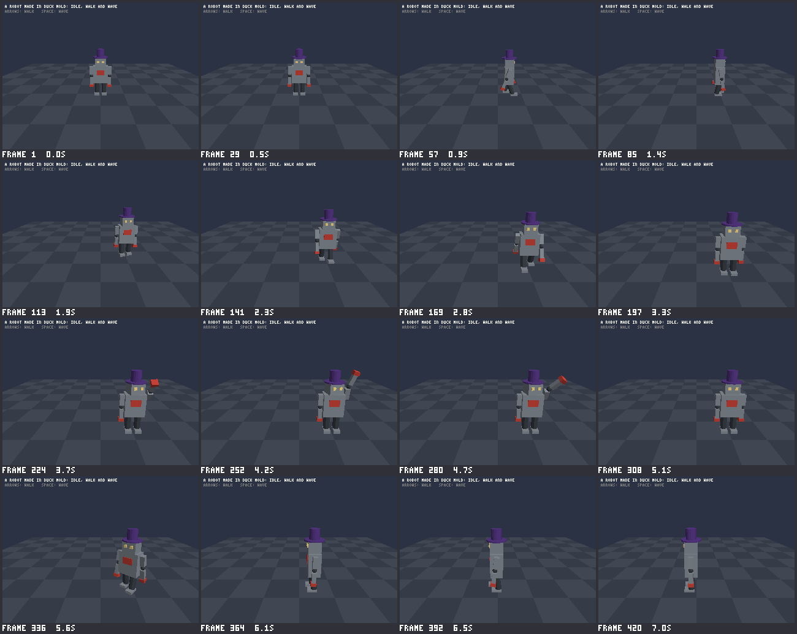

## What works

### 5a, steps 1 to 5 (in short; `PHASE5A_REPORT.md` has it all)

1. **The `.glb` is a tree of parts.** Each part is an object at its
   join. Files exported earlier still load.
2. **Limits.**
   - Written as `limits = { x = [-30, 30] }`, `"fixed"`, or nothing for
     a part that turns freely.
   - Changed with `set-limits`.
   - `inspect --joins` lists the tree the model moves by.
3. **Poses.**
   - Written as `[poses.wave]`, with a line for each part that isn't
     at rest.
   - Edit commands: `set-pose`, `add-pose`, `rename-pose`,
     `remove-pose`, `mirror-pose`.
   - `inspect --pose` and `render --pose` report on and draw a pose.
4. **Animations.**
   - Written as `[animations.walk]`, with keys, `loop` and `smooth`.
   - Edit commands: `add-animation`, `set-animation`,
     `rename-animation`, `remove-animation`, `add-key`, `move-key`,
     `set-key`, `remove-key`.
   - `inspect --animation` checks every frame, thirty a second.
   - `render --animation` draws a strip of frames.
5. **In the file, and in a game.**
   - The animations are standard glTF animations in the `.glb`.
   - In Duck Forge, `AnimatedModel` plays them: play, stop, speed,
     blending, and turning one join from game code.
   - Duck Forge has an example game, `robot_walk`.

### 5b

**Step 6: Pose mode** (O, or the Pose button).

- It works on every model, not just boxes.
- Pick a pose in the list, click a part, and drag a ring. The rings
  stop at the part's limits.
- Letting go of a drag writes one `set-pose`, and is one step to undo.
- R gives the rings and G gives arrows, to move a part.
- A drag while the pose is `rest` makes a new pose rather than change
  the model.
- The list's buttons are edit commands:
  - New is `add-pose`;
  - Copy is `add-pose --from`;
  - Mirror is `mirror-pose`;
  - Rename is `rename-pose`;
  - Remove is `remove-pose`. It asks first when keys use the pose.
- The part's numbers and its limits can be typed in the panel. The
  limits are `set-limits`.
- A pose that leaves a part floating says so under Problems.

**Step 7: the timeline.**

- Every change in it is one key command: `move-key`, `set-key`,
  `remove-key`, `add-key`, `set-animation` (Loop and Smooth), or
  `add-animation` (New).
- A dragged key snaps to 0.05 s and can't pass the keys beside it.
- Clicking a key says which other keys use the same pose, since they
  change with it.
- Turning a part between two keys makes a new pose there
  (`wave_7`), holding every part as it is at that moment. That is
  `add-pose`, the `set-pose`s and `add-key`, done together as one step.
- Ghosts are faint outlines of the poses at the keys before and after.
- Play (Space) plays the animation and stops at its end, or goes round
  if it loops.

**Step 8: the animation library.**

- `duck-mold save-animation <recipe> <animation> <file>` writes the
  animation and the poses it uses to a small file of their own. It
  never writes over a file.
- `duck-mold edit <recipe> add-animation <name> --from <file>` copies
  one in. So does `--starter walk`.
  - `--take <animation>` picks one when the file has several. Any
    recipe can be copied from.
  - If a pose's name is already taken by a pose that says the same
    thing, the pose there is used.
  - If it is taken by a different pose, the new one gets a number
    (`jump_crouch_2`), and the copied keys use that.
  - If the model lacks some of the parts the animation moves, the copy
    is refused, naming them. `--skip-missing` copies the rest.
  - Once copied in, the animation is the model's own.
- **The six starters** come inside the program.
  - `idle`, `walk`, `wave` and `jump` are for a character whose parts
    are named `body`, `head`, `left_arm`, `right_arm`, `left_leg` and
    `right_leg`.
  - `open` is for a part named `door`.
  - `roll` is for four parts named `wheel_front_left`,
    `wheel_front_right`, `wheel_back_left` and `wheel_back_right`.
- In the Studio, the Animations list (above) does the same: Add is
  `add-animation`, and Save is `save-animation`.

**Step 9: the examples**, described above with their strips.

- The robot gets `jump`. `door`, `cart` and `gnome` are new.
- All three new ones are on the start page, and `duck-mold new
  --example` makes a copy of any of them.

**Your two fixes.**

- **`set-socket` now works on a socket written with `at`.**
  - `--facing` turns it. `out` means "as when nothing says", which for
    a socket at a point is up.
  - The new `--at x,y,z` moves it.
  - `--on <side>` puts it on a side, and `--at` puts a socket that was
    on a side at a point.
  - The door's hinge was made this way. The Studio's socket list offers
    a facing for these sockets too.
- **`render --animation --view top`** draws the strip from straight
  above, with the front at the bottom. The door's strip uses it.

**Duck Forge plays every example.**

- Its tests play all eight animations of the four models that move,
  frame by frame, and check each one against Duck Mold's report.
- They also draw each animation at four moments and compare the
  pictures pixel for pixel. The four pictures must all be different.
- Duck Mold's own test does the same through Duck Forge's player, and
  checks where a socket on a moving part ends up.

**Every new action has a line in the agent guide** (`docs/AI_GUIDE.md`):

- the edit table;
- section 11, with a new part, "Sharing animations";
- the list of what each Studio action does in the file.

README, DESIGN (an "As built" note for each step), the Duck Forge
handoff note and the zip's "READ ME FIRST" are updated too.

## How it was checked

| | |
|---|---|
| Duck Mold's tests | 607 pass and none fail. It was 510 at the end of Phase 4 and 570 at the end of 5a. `cargo fmt` and `cargo clippy` are clean. |
| Duck Forge's tests | 671 pass and none fail (on the branch of the open pull request). `fmt` and `clippy` are clean. |
| Through the window | The Studio's window tests drag the rings with the mouse, click and drag keys, scrub the ruler, and press Play, Loop and Space. They also add a starter and save an animation through the panel. |
| Engine tests | Pose mode, the timeline and the library each have tests that drive the Studio without a window. |
| Screen pictures | 5 new ones: Pose mode, a fixed part, the timeline, Play, and the Animations list. Every screen is compared pixel for pixel. |
| Golden files | Model, report and picture for each of the 21 examples, plus a strip and a report for each of the 8 animations. |
| The glTF validator | The official Khronos validator reports no errors, warnings, infos or hints on the robot, door, cart and gnome files. |
| Duck Mold against Duck Forge | Duck Forge's player puts every part where Duck Mold does, in every frame of all 8 animations. This checks the model's box and sockets on parts that move. |
| File sizes | The robot is 85 KB with 4 animations and 8 poses. The door is 15 KB, the cart 62 KB and the gnome 70 KB. |

The results of the checks on GitHub (Windows and Linux, both
repositories) are at the end of this report.

## Known limits

- **No reaching (IK)**, as designed. A foot isn't put on the ground by
  itself: the leg is turned and the body moved until the foot touches.
  `inspect --animation` says how far each foot leaves the ground or
  sinks into it. The starters can't know a model's leg length, so a
  copied walk or jump may need its body move changed, as the gnome's
  was.
- **A starter only knows its six names.** Feet that stick out of a leg
  dig in a little as the leg swings. The robot and gnome turn their
  feet back to stop that; a copied starter doesn't.
- **Parts are rigid.** Nothing bends. Where a leg swings, its top pokes
  into the body a little; `inspect --animation` lists each case.
- **The timeline fits the whole animation to the window.** It doesn't
  scroll or zoom, so keys very close together are hard to pick apart.
- **There is one pose for each key.** A drag changes the pose, so every
  key that uses that pose changes with it. Clicking a key names those
  other keys, and turning a part between keys makes a new pose. There
  is no "make this key's pose its own" button yet: use Copy, then the
  key's right-click menu.
- **Ghosts aren't drawn while the animation plays.**
- **The Animations panel is short and scrolls.** You can drag its top
  edge to make it taller.
- **A saved animation is a copy.** Fixing the saved file doesn't change
  the models that took it, as designed (decision 10).
- **`mirror-pose` and the poses list's Mirror go by names.** `left_...`
  and `right_...` swap.
- **The door's handle** turns on its middle, not at one end, and there
  is no handle on the back of the door.
- **The dog's walk**, which the design listed for this step, isn't
  done. 5b's list didn't have it.
- The 5a limits still stand:
  - the file holds 30 samples a second, with straight steps between
    them;
  - the game moves the model along the ground;
  - a join turned by game code replaces the animation's turn for that
    join.

## What changed from the design

- **`roll` turns `[-360, 0, 0]`.** The design wrote 360. A wheel joined
  to the side of a cart by the end of its cylinder turns around x, and
  the minus is what rolls the cart forward. I found that with a marker
  on a spoke.
- **`idle` doesn't raise and lower the body.** The legs hang from the
  body, so the feet would leave the ground. Instead the head nods and
  the arms sway. **`walk` doesn't dip the body**, because a starter
  can't know how long the legs are.
- **The two-legged starters turn arms and legs only about x.** That is
  the one direction in which a mirrored arm turns the same way as the
  other arm, so the starters work whether or not the right arm is a
  mirror of the left.
- **The starters' poses have names of their own** (`walk_left`,
  `jump_crouch`, `door_open`, `roll_round`), so they rarely clash with
  poses already in a model.
- **`add-animation --from` takes the file's animation with the new
  name, or its only one.** `--take` names another. A copy loops and is
  smooth as the original is.
- **The door opens to 90 degrees, not 100.** At 100 it swings into the
  face of its frame. It is the starter with one number changed, which
  shows how a copy becomes the model's own.
- **The door is joined by the back edge of its own side**, so it turns
  about that edge. Joined by the middle of its side, it either floated
  2 cm from the post mid-swing or cut into it.
- **The robot's jump and the gnome's walk were fitted after copying**,
  with `set-pose`, so their feet stay on the ground.
- **The examples are the four you listed for 5b.** The dog's walk,
  which was in the design, was left for later.
- **The library panel keeps its old name, Library, for parts**, beside
  the new Animations, so nothing that already said "Library" changed.

## What Phase 6 should start with

Phase 5 is complete as designed, apart from the dog's walk. What it
leaves to build on:

- Every part already has a box, a closed shape and a name.
- Every model already moves by its joins.
- The `.glb` already carries the tree.
- The names `colliders` and `lods` were reserved in Phase 0 for exactly
  what comes next.

What I would do, in this order:

1. **Colliders**: shapes a game can test hits against. The simplest
   that is useful: one box (or capsule) for each part, fitted to the
   part, moving with its join.
   - Written in the recipe as `colliders = "parts"`, or one simple
     shape for the whole model.
   - Stored in the `.glb`.
   - Read by Duck Forge, so a game can ask "did this hit the robot's
     head?" and get the part's name.
   - `inspect` and `render` can show them.
2. **Events on keys**: a name on a key (`{ at = 0.4, pose =
   "step_right", event = "footstep" }`). Duck Forge's `AnimatedModel`
   then reports it as the key passes, so a game can play a sound or
   spawn dust at the right moment. It is small, and every game with a
   walk wants it.
3. **LODs**: a simpler version of a model for when it is far away.
   - With the parts already apart, "leave out the small parts" and
     "fewer segments" are both easy, and checkable with `inspect`
     (fewer triangles, same size).
   - Duck Forge picks one by distance.
4. **Leftovers from Phase 5**, if you want them first:
   - the dog's walk on four legs, with four-legged names and a starter
     `trot`;
   - "make this key's pose its own" in the timeline;
   - a timeline that zooms;
   - feet put on the ground by the program (simple two-joint reaching
     for a leg with a knee). The last is the biggest of these. It would
     make every walk fit every character without hand fitting.

My suggestion: colliders and key events together as Phase 6, since a
game needs both as soon as its characters move; LODs after.

## To try it

The Windows zip is built by the Release workflow for this branch. The
link is at the end of this report; you need to be signed in to GitHub
to download it. Unzip it, double-click `DuckMoldStudio.exe`, and:

1. Open **the robot** from the start page.
   - Click **Play** at the top right of the picture, and pick `jump`
     beside it.
   - Press **O** for Pose mode. Pick `wave` in the list, click the left
     arm and drag a ring: it stops at the arm's limits.
   - The timeline is along the bottom. Pick `wave` there and drag a
     key.
2. Open **the gnome**. Under the list of parts, click **Animations**,
   then **Add** next to `jump`: the gnome can jump too. Press Space.
3. Open **the door** and **the cart**, and press Space.

In a Command Prompt in that folder:

```bat
duck-mold render examples\door.toml --animation open --view top
duck-mold save-animation examples\robot.toml wave my_wave.toml
duck-mold edit examples\gnome.toml add-animation hello --from ..\my_wave.toml --skip-missing
duck-mold edit examples\gnome.toml add-animation hop --starter jump
duck-mold inspect examples\gnome.toml --animation hop
```

About these:

- **The third line.** Without `--skip-missing` it is refused, because
  the robot's wave also moves `left_arm/elbow`, and the gnome's arm has
  no elbow. With it, the copy says what it left out.
- **The path to the saved file** is written from the recipe's folder,
  `examples`, so it starts with `..\`.
- **The last line** shows the starter isn't fitted to the gnome yet: its
  feet sink 7 cm into the ground in the crouch. The robot's copy was
  fitted, and the gnome's could be the same way, with `set-pose`.

## The checks on GitHub

| | |
|---|---|
| Duck Mold, 5b | Green on Windows and Linux for steps 6, 7 and 8, the pin, and this report's commit. That last commit also holds step 9: step 9's own run was stopped when the report's commit arrived, as the workflow does. |
| Duck Forge, [Duck-Forge#13](https://github.com/mrguymrguy647-del/Duck-Forge/pull/13) | Green for its commit: the engine's tests on Windows, five times in a row (so the stored pictures of all eight animations are the same on Windows as on Linux, pixel for pixel), and the Studio, zip and installer. |
| The Windows zip | Built: `DuckMold-0.5.0-windows.zip` (8.7 MB), under "Artifacts" at the bottom of [this Release run](https://github.com/mrguymrguy647-del/Duck-Mold/actions/runs/43639534422). It is kept there for 90 days. It isn't a published release: say when you want one. |

Duck Forge's checks on GitHub run on Windows. Its Linux numbers above
are from the machine this was built on.
