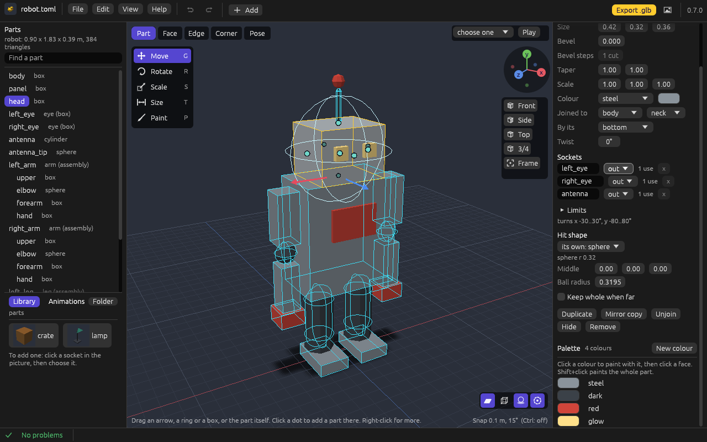
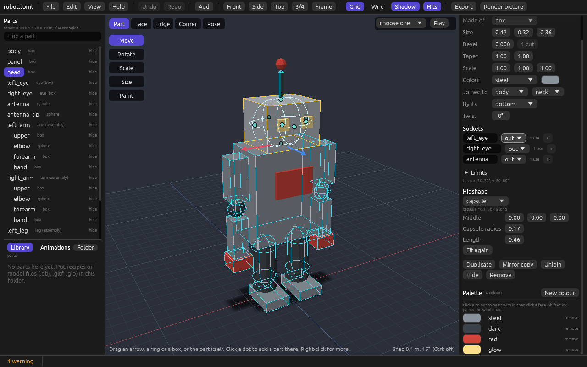
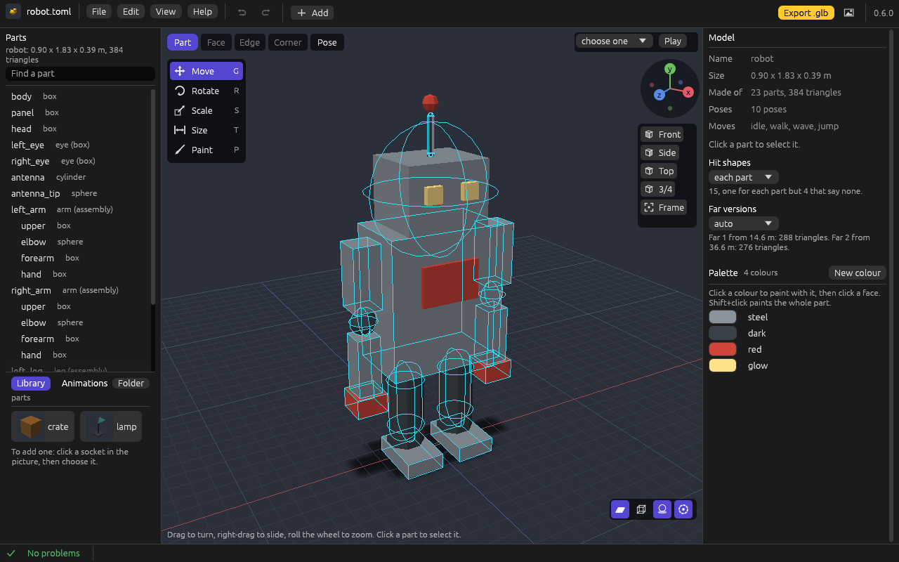
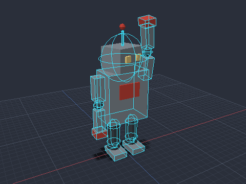
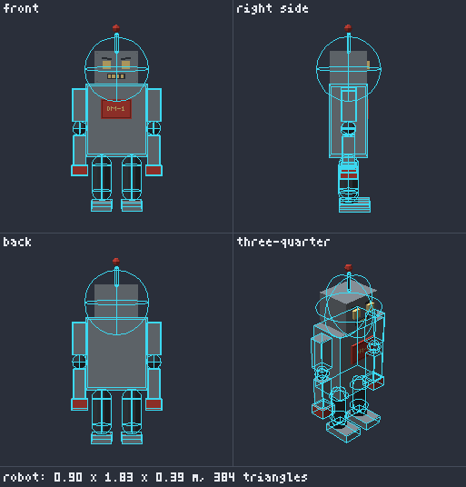
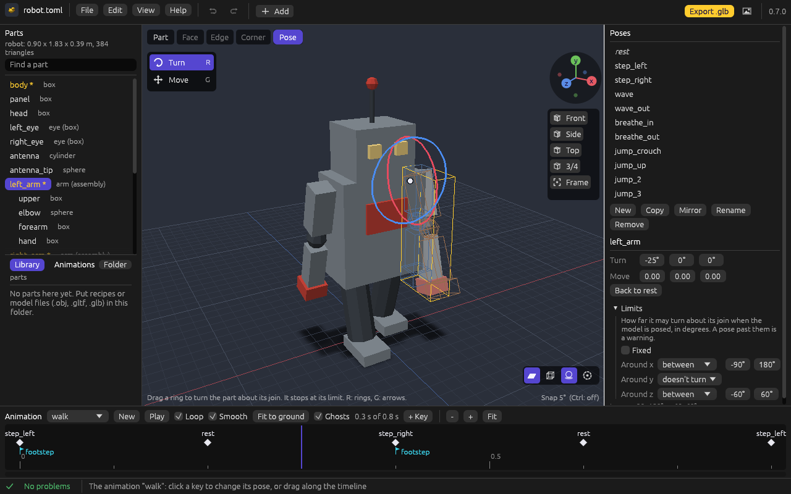
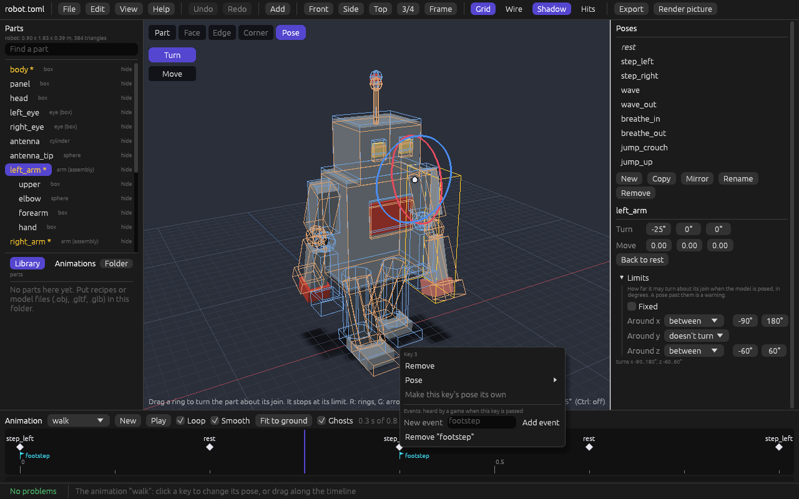
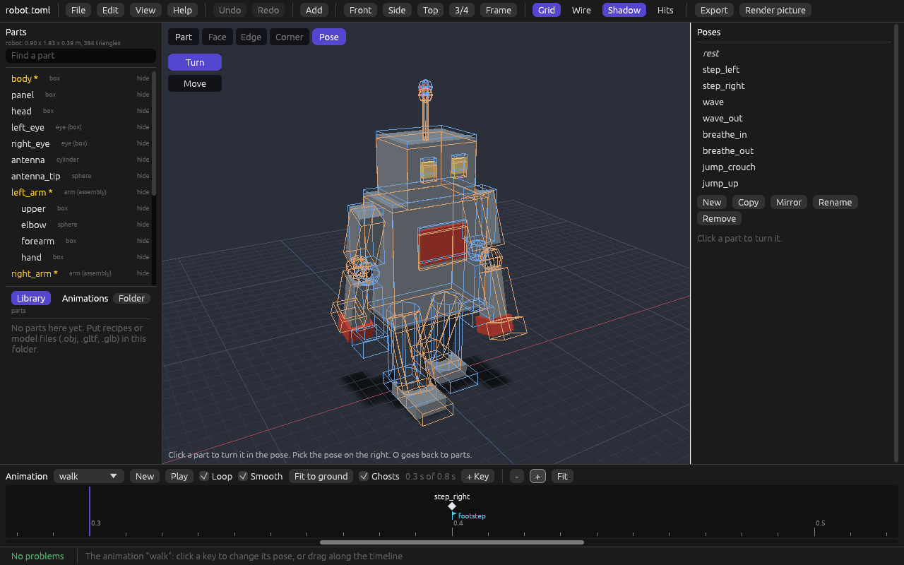
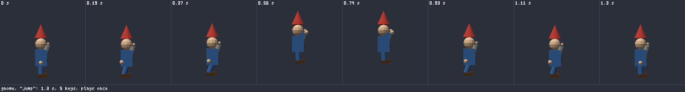
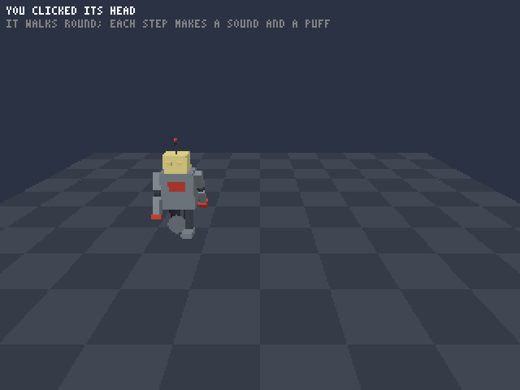

# Duck Mold: Phase 6 report

Phase 6 is "Game-ready". The design is the Phase 6 section of
`DESIGN.md`. You approved all twelve decisions as recommended, with two
additions:

- new models start with `colliders = "parts"`;
- `inspect --animation` warns when a loop has the same event on its first
  and last key.

The goal: a Duck Forge game can use Duck Mold's characters properly. It
can know **what was hit**, and react to **moments in an animation**.

Where the work is:

- **Duck Mold**: the branch `claude/duck-mold-phase-6`, made from `main`
  after [Duck-Mold#8](https://github.com/mrguymrguy647-del/Duck-Mold/pull/8)
  was merged, with one commit for each step. I haven't opened a pull
  request for it: say when you want one.
- **Duck Forge**: two pull requests, the second built on the first.
  - [Duck-Forge#14](https://github.com/mrguymrguy647-del/Duck-Forge/pull/14):
    hit shapes (step 2).
  - [Duck-Forge#15](https://github.com/mrguymrguy647-del/Duck-Forge/pull/15):
    events (step 5), the refitted gnome (step 6) and the example game
    `robot_click` (step 7).

  Duck Mold is still pinned to Duck Forge's `main` at `d944886`, which
  has [Duck-Forge#13](https://github.com/mrguymrguy647-del/Duck-Forge/pull/13).
  Once #14 and #15 are merged, the pin can move.

The rules still hold:

- The recipe is the model.
- Every Studio action is an edit command that agents can run too.
- An edit changes only what it must in the file.
- The viewport is drawn by Duck Forge's CPU renderer.
- Duck Forge's reader is the same code in both repositories. It is now
  version 7, and the shared test files and the handoff note are updated.

## In short

**Hit shapes.**

- One line in a recipe, `colliders = "parts"`, fits a simple shape round
  every part: a box, a ball (for a sphere), or a capsule (for a long,
  round part).
- Each shape moves with its part in every pose and animation.
- A part can say its own shape, or `none`.
- A Duck Forge game asks the model which part a ray, a segment or a ball
  reached, with the model as it stands in this frame:

```rust
if let Some(hit) = ctx.mouse_ray(&camera).and_then(|ray| robot.hit_ray(ray, &place)) {
    println!("you clicked its {}", hit.part); // "head", "left_arm/hand"
}
```

**Events.**

- A key can mark a moment: `{ at = 0.4, pose = "step_right", event =
  "footstep" }`.
- After each update, the game gets the events the animation passed,
  each one exactly once:

```rust
robot.update(ctx.dt());
for event in robot.events() {
    if event.name == "footstep" { ctx.play(step_sound()); }
}
```

**Fitting to the ground.** `duck-mold edit gnome.toml fit-ground walk`
stands each pose of the walk on the ground. It moves the body up or down
until the lowest point touches.

**Two leftovers from Phase 5:**

- "Make this key's pose its own" in the timeline;
- a timeline that zooms and scrolls.

## The new screens

**Hits**, in the top bar, outlines every hit shape in cyan, following
the pose. The selected part's shape is lighter. The properties panel has
a **Hit shape** section for the selected part:

- the list: what the model gives it, a box, a sphere, a capsule, or
  none;
- for a shape of the part's own, its numbers to type and **Fit again**.



A shape with numbers of its own: the head as a capsule lying across it.



With nothing selected, the panel shows the model's line: **Hit shapes**
none, each part, or one capsule, box or ball round it all.



The hit shapes follow the pose. Here the robot waves, and the hand's box
goes up with the hand:



`duck-mold render robot.toml --colliders` draws them in the four views:



**Events on the timeline**: small cyan flags with names, under their
keys.



**A key's menu.** Right-click a key. The menu has:

- a name to type and **Add event**;
- **Remove** for each event the key has;
- **Make this key's pose its own**.



**Fit to ground** is beside Loop and Smooth. **The timeline zooms and
scrolls**:

- the `-`, `+` and **Fit** buttons;
- Ctrl and the wheel, or `-` and `+` with the pointer on the ruler;
- the wheel, or the bar under the ruler, scrolls it.

Here it is zoomed in on the walk's middle:



**The gnome's new jump.** It is the starter `jump`, with its boots
turned flat in the crouch and fitted to the ground with `fit-ground`:



**`robot_click`**, a new example in Duck Forge:

- the robot walks round the floor;
- each footstep plays a short sound and leaves a puff of dust at the foot
  that lands;
- a click says which part it found, and that part flashes. Here, its
  head:



## What works

### Step 1: hit shapes in the recipe and the core

- **`colliders` (top of the recipe)**:
  - `parts` fits a shape to every part;
  - `capsule`, `box` or `sphere` puts one shape round the whole model.
- **How each part's shape is chosen**: a sphere gets a ball; a long
  cylinder, capsule or cone gets a capsule along its length; everything
  else gets a box. The box is measured in the part's own directions, so
  a turned part gets a turned box. Sizes are rounded up, so the shape
  holds every corner.
- **`collider` (on a part)**:
  - `"box"`, `"sphere"` or `"capsule"`: a shape fitted to the part;
  - `"none"`;
  - a table with numbers of its own: `{ shape = "sphere", radius = 0.25 }`.

  A definition can say it, and so can an assembly: then one shape covers
  all the parts inside it.
- **Edits**: `set-colliders` and `set-collider`. Numbers you don't give
  keep the fitted shape's.
- **`inspect`** says how many shapes there are and which parts have
  none. `--colliders` lists every shape.
- **`render --colliders`** draws them in cyan.
- **Warnings**: a shape of the part's own that leaves most of the part
  outside it, or is more than 8 times as big, is the warning `hit_shape`.
- **New models**: `duck-mold new` and the Studio's New model start with
  `colliders = "parts"`.
- **Examples**: the robot, gnome, door and cart have hit shapes.
  - The robot's head is a ball.
  - Its eyes, chest panel and antenna tip are `none`: a hit there names
    the part behind.
  - Every other example is unchanged, byte for byte.

### Step 2: hit shapes in the `.glb` and in Duck Forge

- **In the file**, the shapes are in Duck Mold's corner (`colliders`), at
  rest, each with the node that carries it, like the sockets.
- **Reader version 6** reads them, and moves them with the same join
  positions as the corners and the sockets.
- **In Duck Forge**:
  - `AnimatedModel::hit_ray`, `hit_segment` and `hits_ball` give
    `PartHit { part, point, normal, distance }`;
  - `hit_shapes` lists every shape where it is now;
  - `Camera3D::ray_through(pixel, canvas)` and `Context::mouse_ray(&camera)`
    give the ray under a pixel or under the mouse.

### Step 3: hit shapes in the Studio

- The **Hits** switch (also View > Hit shapes).
- The panel's **Hit shape** section, and the model's line.
- Each change is one `set-collider` or `set-colliders` edit.

### Step 4: events on keys

- **In the recipe**: `event = "footstep"`, or a list of names.
- **Edits**: `set-event` and `remove-event`. Moving a key, changing its
  pose, copying an animation and saving one all keep its events.
- **`inspect --animation`** lists each key's events and says when each
  is heard: `footstep at 0 s (key 1) and 0.4 s (key 3): twice a round`.
- **Your addition**: the same event on a loop's first and last key is
  the warning `event_twice`. The message gives the `remove-event` that
  puts it right.
- **The starters have events**:
  - walk: a `footstep` on each step;
  - jump: `takeoff` and `land`;
  - open: `opened`.

  The robot's and gnome's walks, the robot's jump and the door's open
  have the same.
- **In the Studio**: the flags on the timeline, and the key menu's Add
  event and Remove.

### Step 5: events in the `.glb` and in Duck Forge

- **Reader version 7** reads each animation's events.
- **`AnimatedModel::events()`** lists those passed during the last
  update. The rules a game can count on:
  - Each event is heard exactly once each time its key is passed, however
    the time is cut into updates.
  - An event on the key the animation starts from is heard on the first
    update after `play` or `restart`.
  - On a loop, the end and the start are one moment: an event on the last
    key, then one on the first.
  - Played backwards, events come in reverse order.
  - One long update hears at most ten rounds of a loop.
  - Changing to another animation stops the old one's events at once.
  - Nothing is heard while stopped, finished, at speed 0 or holding a
    pose.

### Step 6: fitting to the ground

- **`fit-ground <animation>`** works pose by pose:
  - It moves the body (the top-level part the others hang from) in each
    pose until the lowest point touches the ground. Only that one number
    changes.
  - A pose that lifts the body (a leap) is left alone unless you add
    `--all`.
  - `--part` names the body when more than one part has others hanging
    from it.
  - The summary names other animations that share the poses, and how far
    the model still sinks between keys.
- **Fit to ground** is a button in the Studio.
- **The gnome**:
  - its walk is fitted: 1.87 cm down in each step, not the 1.7 typed by
    hand;
  - its wave needed nothing;
  - its new jump was fitted after its boots were turned flat.

  Every example animation keeps within 5 mm of the ground.

### Step 7: `robot_click`

See the picture above. It is in Duck Forge as `examples/robot_click/`,
with its recipe in `art/` and an `art/README.md` that says which lines of
the recipe are for the game.

### Step 8: the leftovers

- **Make this key's pose its own.** When other keys, in any animation,
  share the key's pose, the key gets a copy (`walk_1`), and a drag then
  changes only it. It is `add-pose --from` and `set-key` together, one
  step to undo. A `rest` key can always have one.
- **The timeline zooms and scrolls.** It zooms from the whole animation
  down to a fortieth of it, about the pointer. Zoomed in far, the ruler
  marks hundredths of a second. Each animation starts fitted.

## How it was checked

**Duck Mold** (Linux here, and Windows and Linux on GitHub):

- **Hit shapes**:
  - every example part's fitted shape holds every corner of the part, in
    every pose;
  - the shapes the reader moves match Duck Mold's own, in every pose and
    every frame of every animation;
  - damaged files are refused with a sentence.
- **Events**:
  - every way a key can be written, right and wrong;
  - the loop-join warning;
  - both edits;
  - moving, copying and saving keeps events;
  - `inspect` text and JSON;
  - the reader reads them back.
- **`fit-ground`**:
  - each key pose stands exactly on the ground;
  - leaps are left alone, and `--all` fits them;
  - shared poses are named in the summary;
  - `--part` and its mistakes;
  - fitting every example animation stands each key on the ground.
- **The Studio**: a screen test for every new control, and pictures of
  every new screen (above).
- **Golden files** for the changed examples. The Khronos glTF validator
  reports no errors, warnings, infos or hints on the robot, gnome, door
  and cart.
- **The agent guide**: every new edit command has a line in it (a test
  checks this).
- `cargo fmt` and `cargo clippy -D warnings` are clean.

**Duck Forge:**

- **Hit tests**: rays at every part of the robot, the gnome, the door
  and the cart, at rest, in every pose and at five moments of every
  animation. That is over 10,000 rays. Each is checked against a slow
  test that steps along the ray. Also: segments, balls, misses, a model
  that is moved, turned and scaled, and a click through a camera.
- **Events**: every example animation is played looping and once,
  forwards and backwards, with five patterns of update sizes, 180 plays
  in all. What is heard is compared, in order, with a list worked out
  from the events alone.
- **`robot_click`'s own tests**: footsteps and puffs, the walk round the
  square, clicks on five parts while it walks, a miss, and the same game
  twice.

## Known limits

- **A capsule is as long as its part.** So the rim of a cylinder's flat
  end can poke out of the capsule's rounded end by up to 0.42 of its
  radius. A ray that only grazes that rim misses.
- **A model stretched more one way than another** is hit-tested as if it
  were scaled by the largest of its three scales.
- **One shape per part, nothing finer.** A part can't have two shapes.
  An assembly that says nothing gets one shape for each part inside it,
  not one round them all.
- **Hit shapes aren't physics.** A character still needs a physics body
  to stand and bump.
- **`fit-ground` fits the keys, not the frames between them.** Between
  two keys, where a leg turns fast, the model can still dip below the
  ground. The summary says how far. The gnome's jump dips 4 mm. Fitting
  the robot's own jump exactly would make it dip 1 cm, more than the
  4 mm of its hand-tuned crouch, so the robot was left as it was.
- **What counts as a leap** is a pose whose body is moved up. So a
  crouch already raised by an earlier fit is taken for a leap and left
  alone. Turn the feet flat first, then fit, as the gnome's comments say.
- **Ten rounds at most.** A game that skips more than ten rounds of a
  loop in one update hears only the last ten.
- **The Studio's properties panel is longer now**, so it scrolls more.
  The Hits switch has no key.

## What changed from the design

- **`PartHit`, not `Hit`.** Duck Forge's prelude already has a `Hit`
  (a moving box meeting another, in 2D).
- **`ctx.mouse_ray(&camera)` was added.** A game's `update` has no
  canvas, and that's where clicks are handled.
- **Hit shapes are stored in the model's own space**, at rest with the
  node that carries them, like the sockets, not in each part's space.
- **A key's menu has a name field and Add event**, not an
  "Add event..." line that opens a box.
- **The gnome's jump** needed its boots turned flat before fitting. The
  starter only knows six part names, and the guide now says to do this.
- **`robot_click` is in the events pull request** (Duck-Forge#15), not a
  pull request of its own, because it needs both hit shapes and events.
  The refitted gnome's files went there too.
- **The timeline is a little taller**, to hold the flags.

## What Phase 7 should start with

1. **Merge.**
   - Duck-Forge #14, then #15.
   - Then move Duck Mold's Duck Forge pin to that `main`.
   - Open and merge Duck Mold's pull request for this branch.
2. **Fit between keys.** `fit-ground` could add a key where the curve
   dips more than a few millimetres, or warn in `inspect`. Then the
   robot's jump could be fitted too.
3. **A physics body from the hit shapes.** One capsule round the whole
   model, made into a Duck Forge `Body`, would give a character its
   physics body in one line.
4. **Click to select in the Studio by hit shape**, as a game does, to
   check the shapes by hand.
5. **Then the bigger things this phase left out**: parts that bend, IK
   (feet that stand on uneven ground), and the Studio inside Duck Forge's
   Studio.

## To try it

The Windows zip is built by the Release workflow for this branch. The
link is at the end of this report. Unzip it, double-click
`DuckMoldStudio.exe`, and:

1. Open **the robot**.
   - Click **Hits** in the top bar to see its hit shapes.
   - Click its head: the panel's **Hit shape** says it's a ball. Pick
     `box`.
   - Press **O** for Pose mode and pick `walk` in the timeline: two
     cyan `footstep` flags.
   - Right-click the middle key, type `breath` and click **Add event**.
2. Open **the gnome**.
   - Pick `jump` in the timeline, and click **Fit to ground**: the
     status line says it's on the ground already.
   - Zoom the timeline with Ctrl and the wheel.

In a Command Prompt in that folder:

```bat
duck-mold render examples\robot.toml --colliders
duck-mold inspect examples\robot.toml --animation walk
duck-mold edit examples\robot.toml set-event wave 3 hello
duck-mold edit examples\gnome.toml fit-ground walk
```

In Duck Forge, on the branch of Duck-Forge#15:

```bat
cargo run --example robot_click
```

## The checks on GitHub

| | |
|---|---|
| Duck Mold | Green on Windows and Linux for steps 1 to 6, and for the report's commit, which also holds steps 7 and 8 and the version: their own runs were stopped when the next commit arrived, as the workflow does ([run](https://github.com/mrguymrguy647-del/Duck-Mold/actions/runs/43694440386)). |
| Duck Forge, [Duck-Forge#14](https://github.com/mrguymrguy647-del/Duck-Forge/pull/14) | Green: the engine's tests on Windows, five times, and the Studio, zip and installer. |
| Duck Forge, [Duck-Forge#15](https://github.com/mrguymrguy647-del/Duck-Forge/pull/15) | The engine's tests on Windows, five times: green. The Studio's check first failed: its list of the games that come with Duck Forge didn't have the new `robot_click`. Fixed in commit `f517976`; that run is below. |
| The Windows zip | Built: `DuckMold-0.6.0-windows.zip` (8.8 MB), under "Artifacts" at the bottom of [this Release run](https://github.com/mrguymrguy647-del/Duck-Mold/actions/runs/43694440437). It is kept there for 90 days. It isn't a published release: say when you want one. |
