# Duck Mold: Phase 7 report (7a and 7b)

Phase 7 was the last planned phase. It came in two halves:

- **7a, polish and getting ready for games**: never losing work, a
  tidier and faster Studio, far-away versions, a physics body, picking
  by hit shape, a command line made for agents, and the first real
  release, 0.7.0, with an installer.
- **7b, pictures and the three apps together**: images on models, the
  round trip with Duck Quill, models from Blender keeping their
  pictures, Duck Mold's Studio inside Duck Forge Studio with a running
  game that updates as you edit, and version **1.0.0**.

The designs are `DESIGN.md` sections 23 (7a) and 24 (7b). After each
step there is an *As built* note that says where the build differs from
the design and why.

Three repositories changed: Duck Mold (this one), Duck Forge and Duck
Quill.

## In short

### 7a

| Step | What it gives |
|---|---|
| 1. Never lose work | Files are written beside the old one and swapped in. Undo is kept on disk and carries on after a restart. A change by another program is a wall Undo doesn't cross. A recipe deleted while open can be saved again. A crash leaves a note. |
| 2. Layout and messages | A status bar with a problems list, one scrolling column on the right, a Model section, plain-word messages, greyed buttons that say why. |
| 3. The look | 40 drawn icons, one toolbar, an axis gizmo, View > Interface size, a wider start page. |
| 4. Speed | A frame about twice as fast at 2560 x 1440; an edit from the panel about twice as fast. |
| 5. Fit between keys | `fit-ground` adds a key where a jump would dip into the ground. |
| 6. A physics body | `GlbModel::physics_body` in Duck Forge, made from the hit shapes. |
| 7. Picking by hit shape | With Hits on, a click picks what a game's click would; `inspect --ray`. |
| 8. Far-away versions | `lods = "auto"`: two simpler versions, drawn by distance in Duck Forge. |
| 9. The command line for agents | One-line `--json`, `edit --batch`, nearest-first suggestions. |
| 10. The release | Version 0.7.0 with `DuckMoldSetup-0.7.0.exe` and an install test. |

### 7b

| Step | What it gives | Where |
|---|---|---|
| 1. Images in the recipe | `image = "textures/planks.png"` on a part, `images = { front = "..." }` on a face. The image lies over the part's colour. Every shape has a rule for how an image lies on it. `inspect` lists the images and their pixels per metre. | Duck Mold |
| 2. Images in the `.glb` | All of a model's images on one sharp-pixelled sheet inside the file. The shared reader (version 9) and Duck Forge read and draw them. | Duck Mold, Duck Forge |
| 3. The Studio | A row of images under the palette to paint with, each part's images in its properties, a *New image* window. | Duck Mold |
| 4. The round trip | *Paint in Duck Quill* opens the image with a guide of its faces; a save shows on the model in half a second. Any picture program works if Duck Quill isn't there. | Duck Mold, Duck Quill |
| 5. Imported pictures | A glTF file used as a part keeps each material's picture (PNG or JPEG), laid on the way the file says. | Duck Mold |
| 6. Inside Duck Forge Studio | A game's models open in tabs that are Duck Mold's Studio. A running game takes each change at once. | Duck Mold, Duck Forge |
| 7. Examples | The painted robot, a plank crate, a signpost from a glTF file, and Pip, made with all three apps. | all three |
| 8. Version 1.0.0 | Release notes, the installer and its test. | Duck Mold |

## What works in 7b

### Images on a model

```toml
[[parts]]
name = "box"
shape = "box"
color = "wood"
image = "textures/planks.png"                    # every face
images = { top = "textures/lid.png" }            # ...but the top has its own
```

- **The image lies over the colour.** Where the PNG is see-through, the
  part's palette colour shows. So the robot's face is a small picture
  with only brows and a mouth on it.
- **Every shape has a rule.** On flat faces the image is fitted to the
  face as you see it straight on from outside. Round faces are wrapped:
  a cylinder like the label on a tin, a sphere like a map of the world.
  A shaped box keeps an image on the face it was given to through
  pulls, insets and cuts.
- **Pixels stay sharp**, in Duck Mold's pictures and in a game, near and
  far.
- **Mistakes are sentences.** A file that isn't there, isn't a PNG, is
  damaged or is too big names the file and the fix. A PNG cut off at
  every possible length was tried: never a crash.
- **`inspect` says how fine each image is** (pixels per metre on the
  model) and warns when one image's pixels are more than twice as fine
  as another's, since mixed pixel sizes look wrong in pixel art. New
  images are made to match the ones the model has.
- **A model without images is exactly as before.** No golden file of an
  existing example changed in steps 1 to 6.

| The plank crate | The painted robot |
|---|---|
| 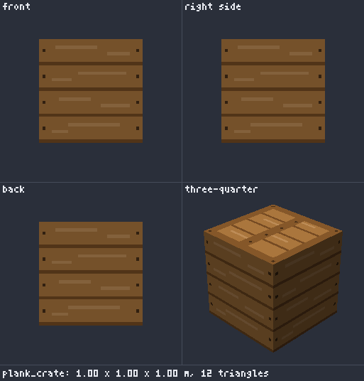 | 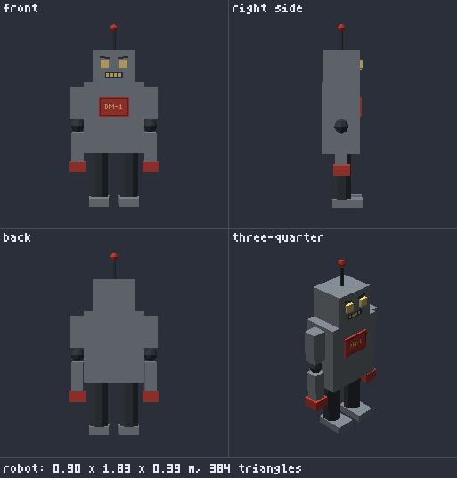 |

### In the Studio

**A model with images.** The Model section counts them, and a row under
the palette shows each one to paint with.

[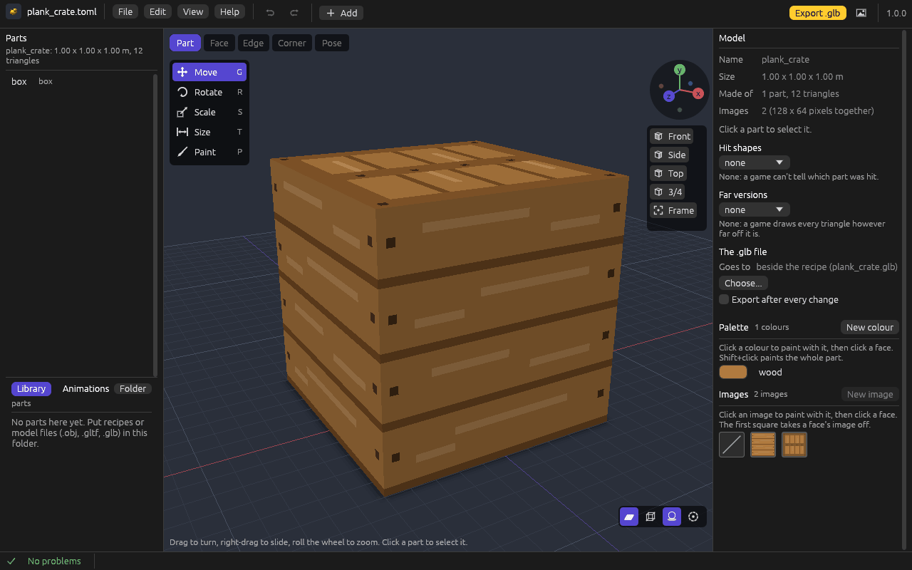](docs/phase7/studio-images.png)

**A part's images.** Each has *Paint in Duck Quill*, *Choose...* and a
cross to take it off.

[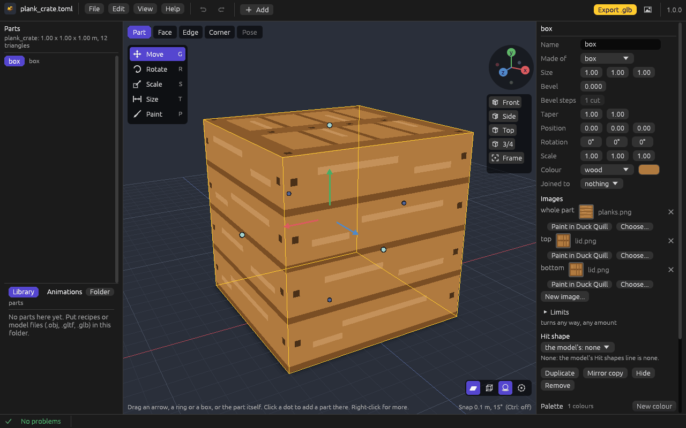](docs/phase7/studio-part-images.png)

**New image.** It works out the right shape and pixel size for the part
or the face it is for.

[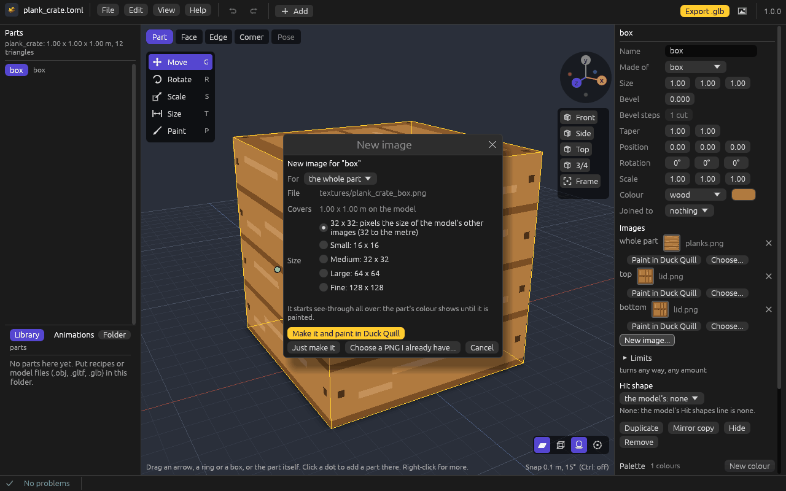](docs/phase7/studio-new-image.png)

**Painting with an image.** Click an image in the row, then a face. The
hint in the picture says what a click would do.

[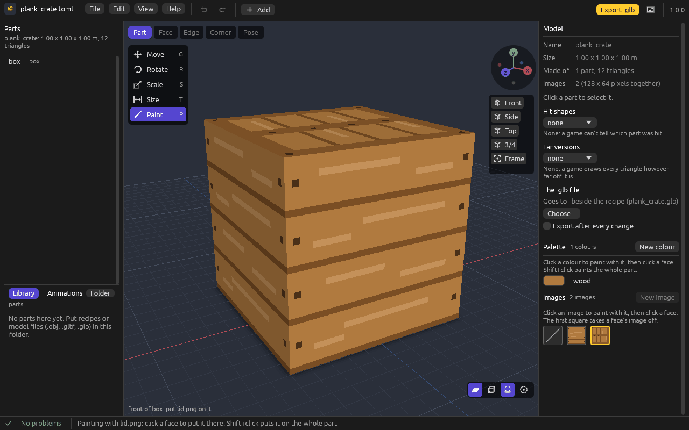](docs/phase7/studio-painting.png)

**The robot's head**, with its face listed under Images.

[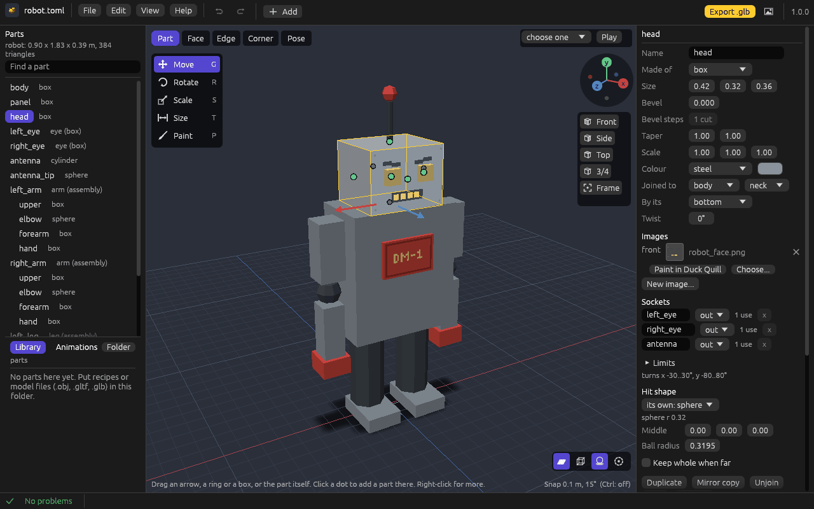](docs/phase7/studio-robot-head.png)

### The round trip with Duck Quill

1. Select a part and press *Paint in Duck Quill* (or Shift+P).
2. Duck Quill opens the picture zoomed in, with a one-pixel brush, on
   paper the colour of the part, with thin lines showing the face and
   which way is up.
3. Paint, and press Ctrl+S there.
4. Within half a second the model in Duck Mold has it. Both windows
   stay open.

Duck Quill keeps the picture's layers in a `.quill` file beside the
PNG. Duck Mold only ever reads the PNG.

This is the picture Duck Quill is given for Pip's face: on the left as
it is on paper the colour of Pip's skin, on the right with the guide's
lines over it. (Put together here from the same files. Duck Quill's own
window could not be drawn in this session: see "Known limits".)

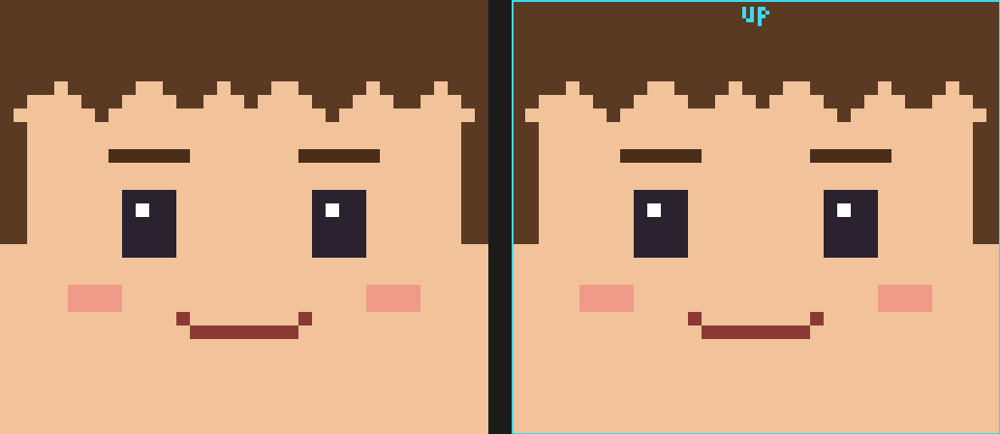

**Without Duck Quill** a window asks once where it is, or offers the
plain way. The choice is remembered.

[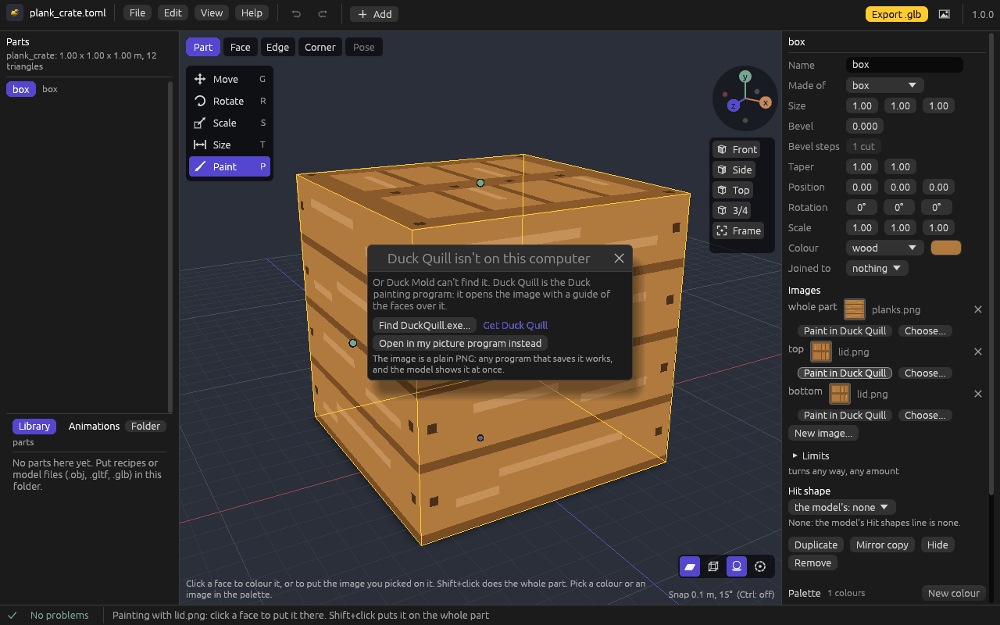](docs/phase7/studio-no-duck-quill.png)

**For an agent** the same trip has no window: `duck-mold new-image`
says the file and its size, any tool writes the PNG (a Duck Quill
script, say), and `duck-mold render` shows it. `duck-mold image-guide`
writes the guide, and `duck-mold paint --dry-run --json` says what the
button would start.

### Models from Blender keep their pictures

A glTF file used as a part brings each material's colour picture: PNG
or JPEG, inside the file or beside it, repeated across a face if the
file says so. Nothing is written in the recipe. The recipe still has
the last word: a colour takes a material's picture off, and `images =
{ board = "mine.png" }` puts another on by the file's own layout.

The signpost example has all three kinds: a PNG beside the file that
repeats up the post, a PNG inside the file, and a JPEG.

| | |
|---|---|
| 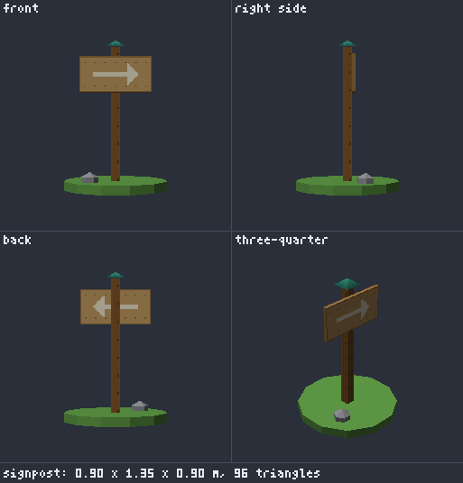 | [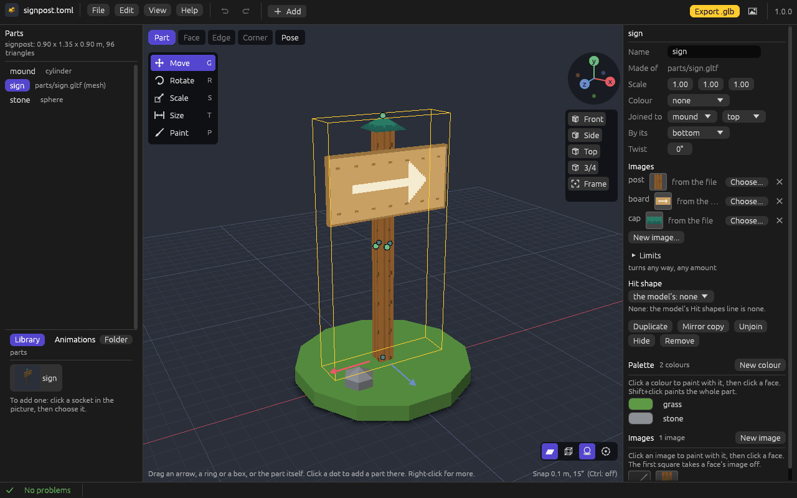](docs/phase7/studio-signpost.png) |

### Straight into a game, and into a game that is running

- A recipe can say where its `.glb` belongs: `export =
  "../assets/robot.glb"`. `duck-mold export` with no `-o`, and the
  Studio's Export, write there.
- *Export after every change*, a tick box in the Model section, writes
  the `.glb` again after each change that builds.
- A Duck Forge game whose `reload` has the line
  `self.robot.reload_if_changed(file)` takes the new model and carries
  on: the same animation at the same moment.

**The Model section** now says where the `.glb` goes.

[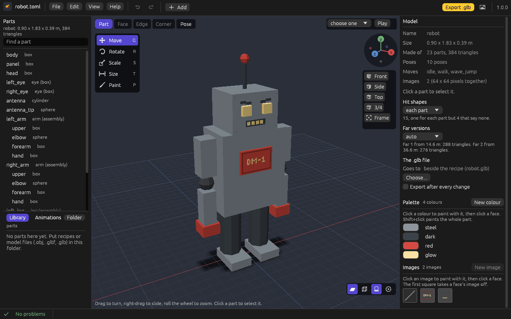](docs/phase7/studio-robot.png)

### Duck Mold inside Duck Forge Studio

Duck Forge Studio shows a game's models in tabs beside the game. A tab
is Duck Mold's Studio itself: the same screens from the same code, used
as a library. There, Export reads **Send to game**, and the model is
sent after every change. Undo is the same Undo, kept on disk, so a
change made in one Studio can be undone in the other.

**Pip's game playing in Duck Forge Studio.**

[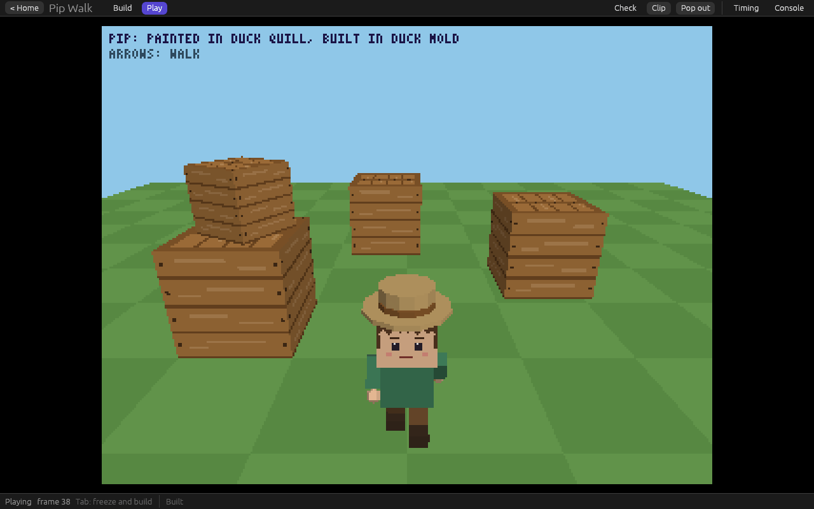](docs/phase7/forge-pip-game.png)

**Pip's recipe open in a tab**, with the running game in the corner.

[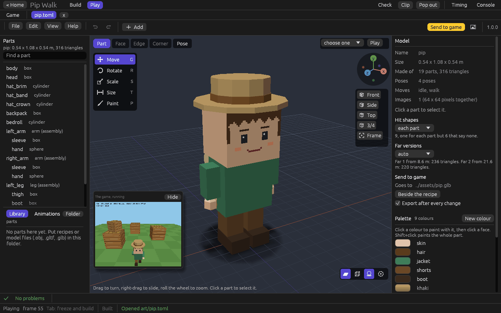](docs/phase7/forge-pip-tab.png)

**A model with no game running** (the test's crate).

[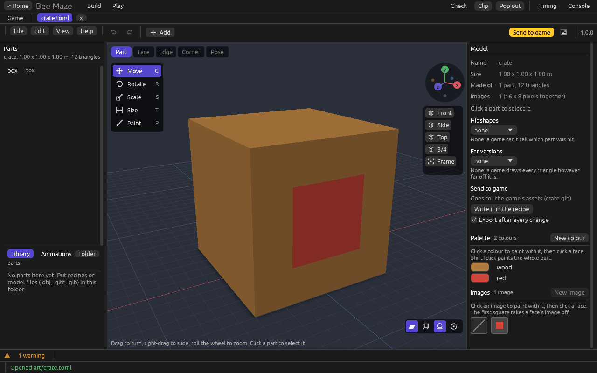](docs/phase7/forge-model-tab.png)

**The same Studio "hosted"**, as Duck Mold's own tests draw it: no
start page, no File > Open, and *Send to game*.

[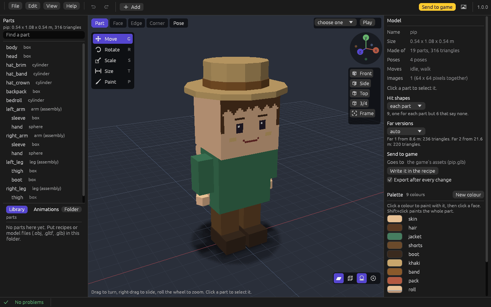](docs/phase7/studio-hosted.png)

How the code is shared, in one line each:

- The engine never uses Duck Mold. Only Duck Forge Studio does.
- Duck Forge Studio names one commit of Duck Mold. Duck Mold names one
  commit of the engine.
- Inside the tab Duck Mold draws with the engine commit that Duck Mold
  names, so a change to the engine can't break the tab.
- A test in Duck Forge Studio sends a model with an image from the tab
  and loads it with its own engine, so the two can't drift apart
  unnoticed.

For agents, Duck Forge Studio has `model.open`, `model.edit` (one Duck
Mold edit, in Duck Mold's own words), `model.send`, `model.close` and
`model.show`.

### One character made with all three apps: Pip

- **Duck Quill** painted the face
  (`examples/textures/pip_face.json` is the script).
- **Duck Mold** put Pip together and animated it (`examples/pip.toml`):
  `idle`, and `walk` with a footstep on each step, hit shapes, two
  far-away versions.
- **Duck Forge** walks Pip round a yard of plank crates
  (`examples/pip_walk` there).

| Pip | Pip's walk |
|---|---|
| 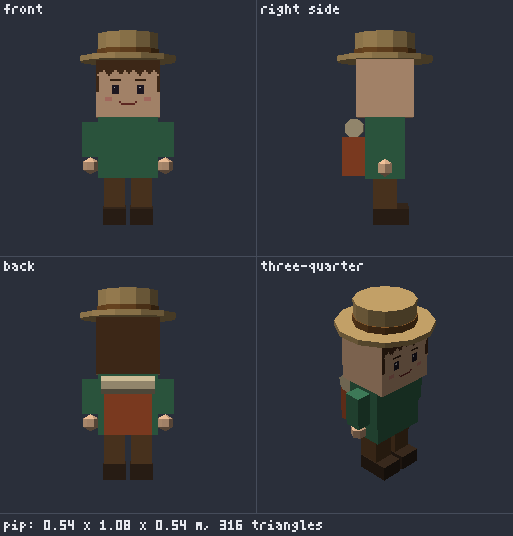 | 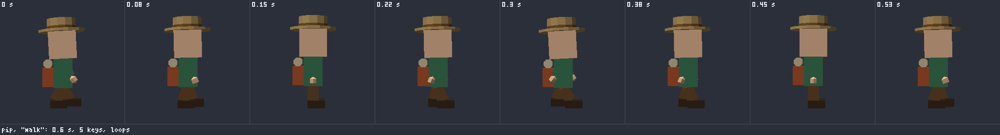 |

**Pip in Duck Mold's Studio**, and mid-walk in Pose mode.

[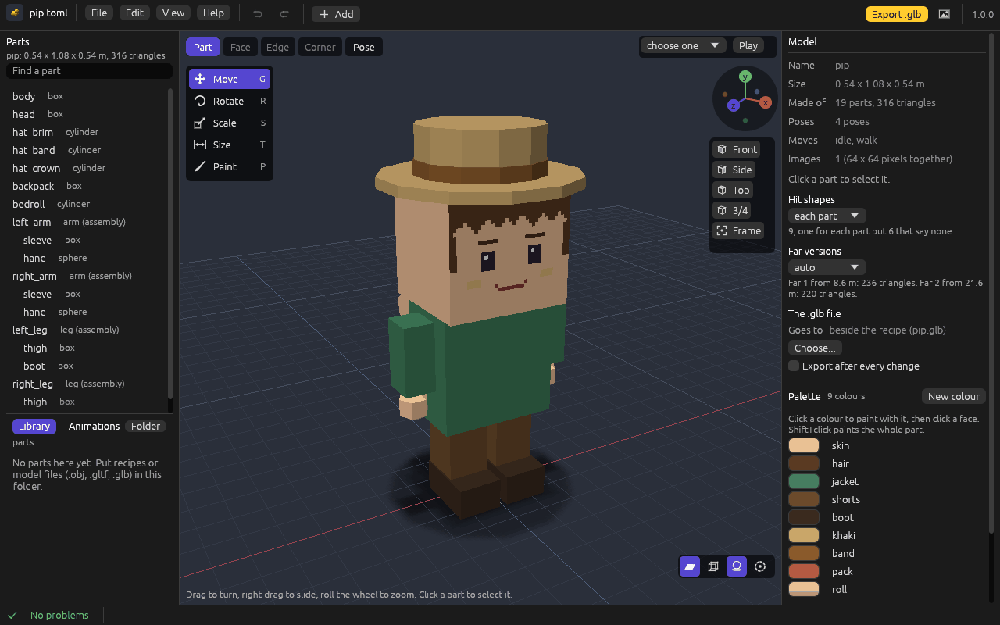](docs/phase7/studio-pip.png)

[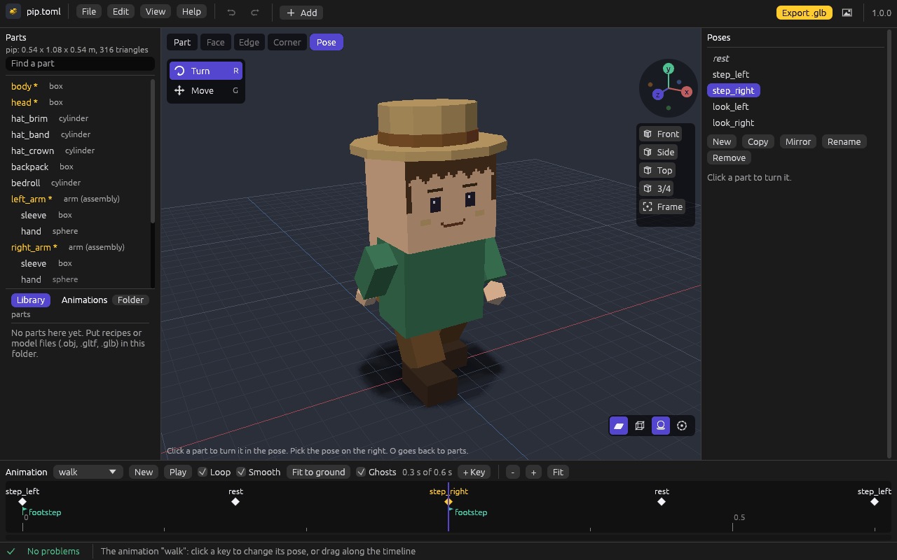](docs/phase7/studio-pip-walking.png)

**Three frames of the game.**

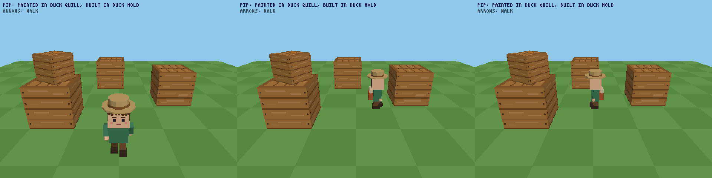

**The start page**, with the four examples that are new or changed in
1.0 first.

[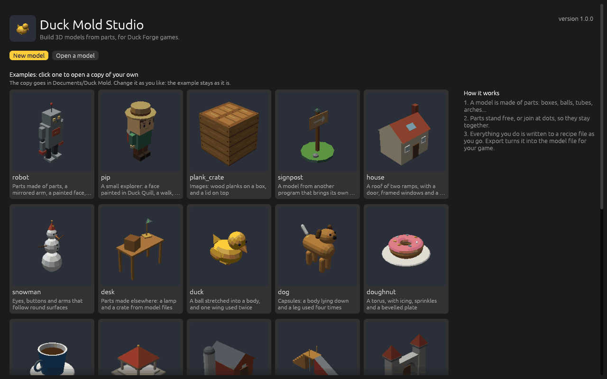](docs/phase7/studio-start-page.png)

## What works in 7a

The full account, with speed numbers and all 79 screens drawn before
and after at two sizes, is `PHASE7A_REPORT.md`. In brief:

- **Never lose work.** Safe writes, Undo on disk (100 steps for each
  recipe), walls in Undo where another program changed the file, a bar
  to save a deleted recipe again, a crash note.
- **The Studio.** One toolbar with drawn icons, a status bar with the
  problems behind it, one scrolling right column, a Model section, an
  axis gizmo, interface sizes from 90 to 200%.
- **Speed**, on a model of 50 parts and 21,660 triangles: a frame at
  2560 x 1440 went from 30 to 37 ms down to 13 to 16; an edit from the
  panel from 57 to 69 ms down to 34.
- **For games.** Far-away versions, a physics body, picking by hit
  shape, `fit-ground` between keys.
- **For agents.** One-line `--json`, `edit --batch`, a grouped
  `edit --help`.
- **The release.** An installer that needs no administrator, with a
  test that installs it, installs over it and uninstalls it.

Two of 7a's screens, before and after (the rest are in
`PHASE7A_REPORT.md`, "Every screen, before and after"):

| | Before (0.6.0) | After (0.7.0) |
|---|---|---|
| The start page | [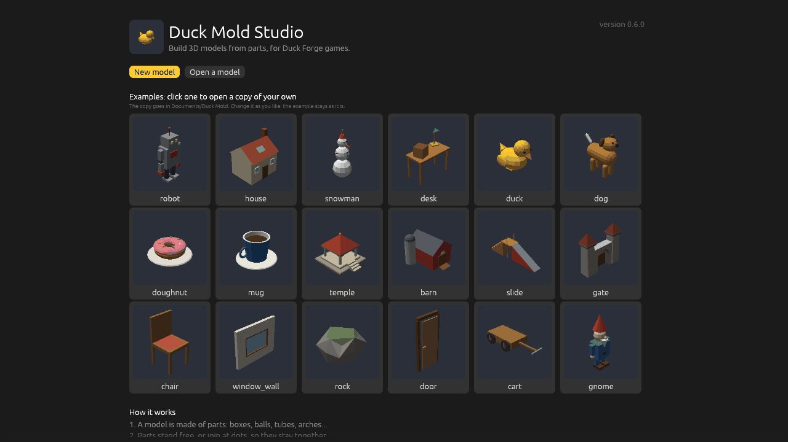](docs/audit/1280x720/01-start-first-time.png) | [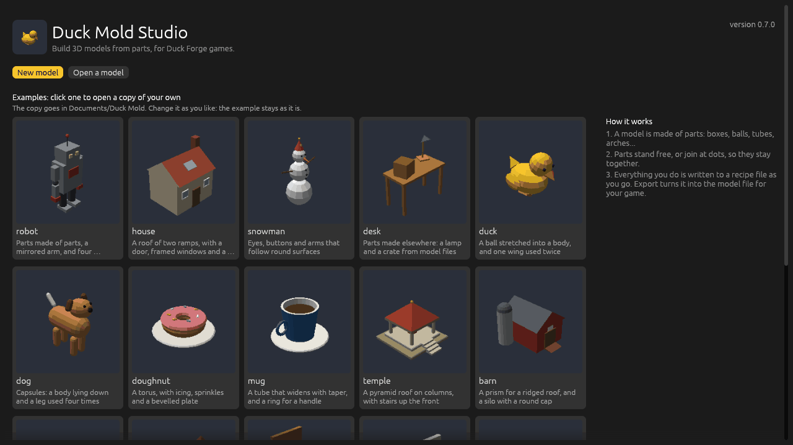](docs/audit-7a/1280x720/01-start-first-time.png) |

## Every screen that changed in 7b

Every picture above is one of them. As a list:

| Screen | What changed | Picture |
|---|---|---|
| The start page | Four examples new or changed: the painted robot, Pip, the plank crate, the signpost | `docs/phase7/studio-start-page.png` |
| Any model, nothing selected | The Model section counts the images and says where the `.glb` goes, with *Export after every change* | `docs/phase7/studio-robot.png` |
| The palette | A row of the model's images under the colours | `docs/phase7/studio-images.png` |
| A part's properties | An Images section: each image, *Paint in Duck Quill*, *Choose...*, a cross, *New image...* | `docs/phase7/studio-part-images.png`, `studio-robot-head.png` |
| New image (new window) | What it is for, its file, what it covers, its size | `docs/phase7/studio-new-image.png` |
| The picture, with the Paint tool | Models are drawn with their images; the hint says what a click with an image would do | `docs/phase7/studio-painting.png` |
| Duck Quill isn't here (new window) | Find it, get it, or use any picture program | `docs/phase7/studio-no-duck-quill.png` |
| A part from a mesh file | Its own pictures listed as "from the file" | `docs/phase7/studio-signpost.png` |
| Edit and Help menus | *Paint in Duck Quill* (Shift+P); *Duck Quill...* | (in the menus) |
| Hosted (new) | The Studio inside another program's window | `docs/phase7/studio-hosted.png` |
| Duck Forge Studio: the tabs (new) | The game, and each open model | `docs/phase7/forge-pip-tab.png`, `forge-model-tab.png` |
| Duck Forge Studio: Files panel | A "model" kind; a click opens a tab | (a word beside the file) |

The pictures in `docs/phase7/` were drawn with no window by the
Studios' own tests, at 1280 x 800, and cut to 128 colours to keep the
files small.

## Tests

- **Duck Mold: 804 tests pass** on Linux, with 3 ignored on purpose
  (the speed test, the audit, and the test that draws the pictures
  above). 7a ended on 695.
- New in 7b: how an image lies on every shape and every face name;
  mistakes with images; the sheet; the `.glb` and its round trip; the
  shared reader; the image edits; the Studio's image screens; the round
  trip with a stand-in for Duck Quill; `paint` and `image-guide`;
  imported pictures (15 tests, with a JPEG read to the same pixels on
  every computer); the `export` line and `set-export`; the hosted
  Studio; golden files for the plank crate, the signpost, the painted
  robot and Pip.
- **The Khronos glTF validator** reports no errors, warnings, infos or
  hints on the plank crate's and the signpost's `.glb`.
- **Duck Forge: 784 engine tests pass**, with and without its default
  features, and its Studio's tests pass (they build and play real
  games). New: images drawn on the CPU and on the graphics card; the
  painted robot's face sharp in every far-away version; a model
  reloaded mid-walk; the model commands; the tab; and a test that
  plays the real robot example in the Studio, changes its recipe,
  sends it, and checks the running robot changed without starting
  again.
- **Duck Quill**: its tests pass on Windows and Linux, with new ones
  for opening and saving PNG pictures.
- `cargo fmt --check` and `cargo clippy -D warnings` are clean in Duck
  Mold; Duck Forge and Duck Quill are formatted and clippy-clean too.

## Known limits

**Not seen by a person's eyes on Windows.** Everything was built and
tested on Linux with no screen, and by GitHub's Windows machines. In
particular:

- Duck Quill's window opening a PNG, with the guide and the paper, was
  tested through the code behind it, not looked at.
- Duck Mold's tab inside Duck Forge Studio was drawn with no window and
  looked at as a picture, not clicked through on a real PC.
- The installer is installed, installed over and uninstalled by
  GitHub's Windows machine, silently.

**The Studio's stored screens** are compared on Linux with one graphics
driver, which this session's machine doesn't have. CI draws them and
keeps them with the run, and they are put in the repository from there.

**Images.**

- An image is a PNG of at most 1024 x 1024 pixels, stretched to fit its
  face. It doesn't repeat. (A picture that came inside a model from
  another program can repeat, up to 8 times each way.)
- All of a model's images together must fit in 4096 x 4096 pixels.
- A bevelled edge never takes an image: it keeps its colour.
- Where an image is half see-through, the mix with the part's colour is
  worked out once, when the model is exported. A game can't change the
  colour under an image afterwards without painting over the image too
  (it tints both).
- Two meshes with different pictures can't be merged into one in Duck
  Forge.
- A `.glb` with images needs a Duck Forge with reader version 9. An
  older one refuses it with "update Duck Forge".

**Imported pictures.**

- Only a material's colour picture is read. Bump, shine and glow maps
  are left out with a note, as is the extension that moves or turns a
  picture on its faces.
- A picture bigger than 1024 pixels a side is made smaller.
- glTF's see-through materials show the material's colour where the
  picture is see-through: Duck Mold has no see-through faces.
- An OBJ file's `.mtl` still isn't read (its layout is, so the recipe
  can put images on its materials).
- A `.glb` Duck Mold wrote, used as a part, keeps its images, but its
  faces under an image come in under the material `default`.

**Duck Mold inside Duck Forge Studio.**

- Duck Forge Studio's program holds the engine's drawing code twice
  (its own, and the copy Duck Mold names). That was the price of the
  tab never breaking when the engine changes.
- The game keeps running while a model's tab is in front, but its keys
  go to Duck Mold. Freeze the game first if it shouldn't play on.
- In a recorded playthrough, a model change is kept as "this file
  changed", not as the file's bytes. A replay is the same only if the
  file is.
- A plain `Mesh` (not an `AnimatedModel`) has no one-line reload: the
  game loads it again itself.

**From 7a, unchanged:** a drag step on a very big model is 14 to 16 ms,
not under 12; the program is unsigned, so Windows asks once; a far
version can open a gap of millimetres between touching parts.

**From earlier phases, unchanged:** only a box can be shaped; faces
where two parts meet are kept; no IK.

## What a Phase 8 could be

Nothing is planned. These are the things that came up most often while
building Phase 7, roughly in the order they would help:

1. **A person's pass on Windows.** An hour with each of the three apps
   on a real PC, clicking through the round trip and the tab, with a
   list of what feels wrong. Everything here was tested by programs.
2. **Parts that bend.** A character's arm is two stiff boxes today.
   Bones and skinning would let one mesh bend at the elbow. This is
   the biggest thing 7b left out on purpose, and it touches the recipe,
   the `.glb`, the reader and Duck Forge.
3. **IK for posing.** Drag a hand and have the arm follow, instead of
   turning each join.
4. **Shaping more than boxes.** Pull a face of a cylinder; cut a hole
   through a part (booleans).
5. **Images that repeat, and a second layer.** Tiled bricks on a long
   wall from a small PNG; a decal over a base image.
6. **Signing the programs**, so Windows doesn't ask.
7. **Sharing one engine in Duck Forge Studio.** If the engine's drawing
   code settles, the Studio could use one copy for both, and shrink.
8. **Duck Quill inside the same window**, as Duck Mold now is inside
   Duck Forge Studio: painting a face without leaving the model.
9. **Shiny, glowing and see-through surfaces**, with the lit renderer
   Duck Forge already has for games that ask for it.
10. **A library of ready-made characters and props** built from the
    examples, to start a game from.
