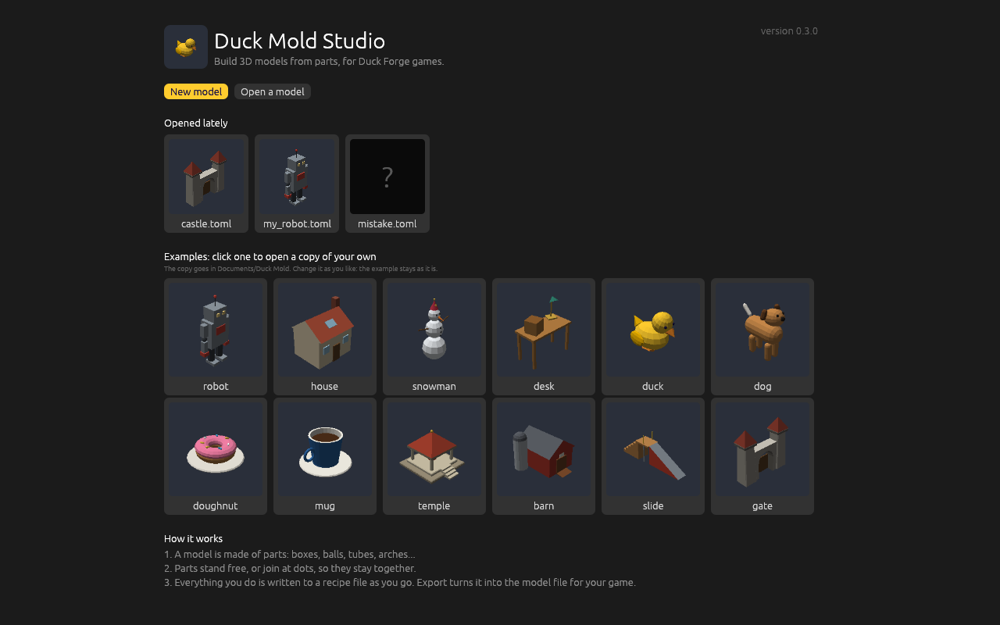
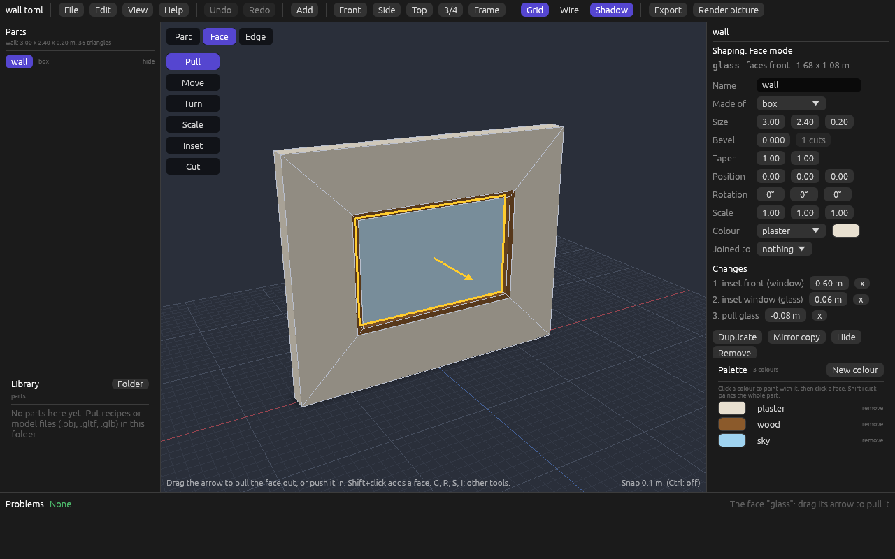

# Duck Mold


Duck Mold makes game-ready 3D models from parts. You describe a model in
a short file, a **recipe**: which parts it has, which part joins which,
and what colour each is. You can type the recipe, or build it with the
mouse in **Duck Mold Studio**, which writes the same file. Duck Mold
builds the model, tells you in words and numbers how it came out, and
writes a `.glb` file for the
[Duck Forge](https://github.com/mrguymrguy647-del/Duck-Forge) game engine.

It is not a sculpting program. It is an assembler: you don't push points
around, you name parts and say how they fit together. It belongs with
[Duck Quill](https://github.com/mrguymrguy647-del/duck-quill) (2D art)
and [Duck Echo](https://github.com/mrguymrguy647-del/Duck-Echo) (sound),
and like them it is made for two kinds of user: people who don't know
3D modelling or Rust, and AI agents.

**An AI agent?** Read [docs/AI_GUIDE.md](docs/AI_GUIDE.md), or run
`duck-mold guide`: the whole tool on one page, from scratch.

## Start the Studio on Windows, without a terminal

- **From a download:** get `DuckMold-<version>-windows.zip` from the
  [Releases](https://github.com/mrguymrguy647-del/Duck-Mold/releases)
  page, unzip it, and double-click `DuckMoldStudio.exe`. `READ ME
  FIRST.txt` in the folder says the rest. `Create desktop shortcut.bat`
  puts the duck on your desktop.
- **From a copy of this repository:** install Rust from
  <https://rustup.rs>, then double-click `Start Duck Mold Studio.bat`.
  It builds the Studio (a few minutes the first time) and starts it.
  `Create desktop shortcut.bat` puts a shortcut on your desktop.

The Studio opens on a page with **Open a model**, **New model** and the
recipes you opened lately. You can also drop a recipe file on
`DuckMoldStudio.exe`, or on its shortcut, to open it. No black console
window opens behind it.

The rest of this page builds a model by typing first, because that
shows what a recipe is; the Studio comes at step 6 of the quick start.

## A first model

```toml
version = 0
name = "tree"

[palette]
bark = "#6B4A2B"
leaf = "#3F8F4A"

[[parts]]
name = "trunk"
shape = "cylinder"
radius = 0.15
height = 1.2
color = "bark"

[[parts]]
name = "leaves"
shape = "cone"
radius = 0.7
height = 1.6
color = "leaf"
attach = "bottom"       # my socket...
to = "trunk.top"        # ...joins the trunk's socket
```

There are no positions in it. Every part has sockets (named points:
`top`, `bottom`, `left`, `right`, `front`, `back`, `center`), and
`attach` and `to` join one part's socket to another's. The cone sits on
the trunk because its `bottom` is joined to the trunk's `top`.

## Quick start

1. Install Rust from <https://rustup.rs> (version 1.95 or newer).
2. Get this repository, and in its folder run:

```bash
cargo build --release
```

The program is `target/release/duck-mold` (`target\release\duck-mold.exe`
on Windows). The first build takes under a minute.

3. Look at an example without writing anything:

```bash
target/release/duck-mold inspect examples/robot.toml
```

4. Build it:

```bash
target/release/duck-mold export examples/robot.toml
```

That writes `examples/robot.glb`. Any glTF viewer opens it: the 3D
Viewer that comes with Windows, Blender, or an online glTF viewer.

5. See it:

```bash
target/release/duck-mold render examples/robot.toml
```

That writes `examples/robot.png`, four views of the model on one sheet,
without opening a window:


6. Or open it in the Studio, the window where a model is built with the
   mouse:

```bash
target/release/duck-mold studio examples/robot.toml
```

Started with no file (or by double-clicking it), the Studio shows its
**start page**: New model and Open a model; the models you opened
lately, each with its picture; and the **examples**, fifteen of them,
each with its picture. Click an example to open a copy of your own: the
copy goes in the folder `Duck Mold` in your Documents (as `robot.toml`,
or `robot_2.toml` if that is taken), so you can change it as you like
and the example stays as it is. The examples are inside the program, so
they are there wherever it was started from. File > Open an example and
File > Opened lately offer the same lists once a model is open.



The first model you open to work on gets **five small tips**, one at a
time, each pointing at what it is about: the picture, a part, the
arrows, a dot, the Add button. Next goes on; Skip the tips ends them.
They are shown once; Help > Show the tips again brings them back.

Drag with the left mouse button to turn the model, with the right one
to slide it, and roll the wheel to come closer. The parts are listed on
the left, and what is wrong with the recipe (if anything) at the bottom.
Click a part, in the picture or in the list, to select it: it lights up
in both. (A part made of parts, like the robot's arm, is selected whole
first; click again for the part inside.)

The selected part's **properties** are on the right: its name, what it
is made of, its sizes, its colour (from the palette, or a new one), what
it is joined to, and its twist, with buttons to duplicate it, make a
mirror copy, or remove it. Changing a value changes the recipe file at
once, and only where it has to: comments and layout stay. A part that
comes from a definition says so first, and names every other part the
change would reach:

> Made from the definition "eye". Changing its shape, size or colour
> also changes: right_eye.

**Moving, turning and sizing a part.** Four tools stand down the left
edge of the picture, each with a key. They put handles on the selected
part:

| Tool | Key | Handles | Dragging one |
|---|---|---|---|
| Move | G | Three arrows: red, green, blue | Moves the part left-right, up-down or front-back. Dragging the part itself slides it over the ground. |
| Rotate | R | Three rings | Turns it, 15 degrees at a time. |
| Scale | S | Three small boxes, and one in the middle | Stretches it one way, or makes all of it bigger or smaller. Works on any part. |
| Size | T | A round knob on each face of a shape | Pulls that face out or in: changes the shape's own width, height, depth or radius. The face opposite stays where it is. |

- That is for a **free** part: one that is joined to nothing (a
  duplicate, say). A **joined** part slides along the surface it sits
  on, and has one ring, which twists it around its join. **Unjoin** in
  the properties panel makes it free, right where it is.
- Moves go in steps of 10 cm (1 cm when you are zoomed in close). Hold
  **Ctrl** to move freely.
- While you drag, the part moves under the pointer and a label shows
  the number. The recipe is written once, when you let go, so one drag
  is one step to undo. Escape lets go without changing anything.
- The same numbers are in the properties panel (Position, Rotation,
  Scale), to type.
- The ground is always under the lowest part, because a game stands a
  model on its underside. So lifting the lowest part leaves it on the
  ground and brings the others down, and lifting the only part shows
  nothing. The Studio says so when it happens.


**Shaping a box.** Select a box and press **Tab** (or click **Face**,
above the tools): the Studio is in Face mode. The other parts fade, the
box's faces are outlined, and a click picks a face, by the name the
recipe calls it (`top`, `front`...). Shift+click adds a face.

| Tool | Key | Handle | Dragging it |
|---|---|---|---|
| Pull | T | An arrow out of the faces selected | Pulls them out the way they face, with new walls round them, or pushes them in to make a hollow. Steps of 10 cm (1 cm close up); Ctrl: free. |
| Move | G | Three arrows, along the part's own directions | Slides the faces; the faces round them stretch to follow. |
| Turn | R | Three rings | Turns the faces about their middle, 15 degrees at a time. The faces round them bend. |
| Scale | S | Three boxes, and one in the middle | Makes the faces bigger or smaller one way, or all ways: a box with its top scaled down is a frustum. |
| Inset | I | A knob on the middle of an edge | Dragged in, makes a smaller face inside each face: a frame round it, in steps of 1 cm. The new face in the middle is selected, ready to pull. |

- **Edges.** Press **E** (or click **Edge**): a click picks an edge, by
  the faces that meet there (`top+front`), and Move's arrows move it;
  the faces on both sides follow.
- **Corners.** Press **C** (or click **Corner**): the box's corners
  show as dots; a click picks one, by the faces that meet there
  (`top+front+left`), and Move's arrows move it. A face that bends is
  drawn as two triangles, folded the way that bulges out. Cut a box
  through its middle three ways first, and it has 26 corners to make a
  rock of.
- **Cut** (K, in Face and Edge mode) shows a ring all the way round the
  box where you point, across the edge under the pointer. Click, and
  every face the ring crosses becomes two: more faces to pull and
  move. The place is a share of the way from the middle to the side,
  in tenths (hold Ctrl for any place), so it stays near that side when
  the box is resized. The slices are named by the side:
  `top_right`.
- What you do is a list of **changes** under the box in the recipe
  (`changes = [ { inset = "front", by = 0.6 }, ... ]`), and the panel
  lists them: change a number to change that step, or click **x** to
  take it away. The box keeps its size, so make it wider and the
  window stays 60 cm in from the sides.
- A drag that would turn the shape inside out, or push a face through
  another, shows its label in red, saying why, and nothing is written
  when you let go.
- **New faces work like old ones.** The Paint tool paints them by
  their names (`colors = { glass = "sky" }`), and in Part mode a click
  on one makes a socket on it (`on = "glass"`), so a part can be added
  there; the socket moves with the face.
- **Using it again.** Right-click the part: **Make a definition...**
  moves what it is made of (shape, size, changes, colours, sockets) to
  `[define.<name>]` and the part uses it, so Add > Defined in this
  recipe makes more, and shaping one shapes them all. **Save to the
  library** writes it alone to `parts/<name>.toml`, with the colours it
  uses, and it shows in the library at once.
- Faces can't be deleted (a shape must stay closed): Undo, or the
  Changes list, takes a change back.
- Escape lets go of the faces, then leaves Face mode. Tab goes back to
  parts too.
- Only a box can be shaped in this version (with or without a taper,
  without a bevel). Changing its shape to another drops its changes,
  and says so; Undo brings them back.

Dragging the same face again with Move, Turn or Scale adds to the line
already there instead of writing another. In the file these are
`pull`, `inset`, `move-face`, `turn-face`, `scale-face`, `move-edge`,
`move-corner`, `cut`, `set-change` and `remove-change` edits; `duck-mold inspect <recipe> --faces` lists
every face's name.



**Adding parts.** There are two ways.

- **Add**, in the top bar, lists the shapes (each with a small
  picture), the parts the recipe defines and the library. Pick one and
  it stands on the ground in the middle of what you are looking at, or
  just in front of whatever already stands there, joined to nothing.
  It is selected, with the Move arrows on it, so you can drag it
  straight away. (`duck-mold edit <recipe> add <name>` with no place
  does the same, walking towards the model's front.)
- The selected part's sockets show as small round dots. Click a dot
  and pick what to add there: one of the twelve shapes, or a
  part the recipe defines. The new part is about half the size of the
  one it sits on, has its colour, and is selected, ready to change.
- To join a part that is already there, drag it onto a dot of another
  part.
  The dots of the parts it could join light up while you drag. A joined
  part dropped on another part's surface goes to that point: the Studio
  declares a socket there (`on` a side, with a `shift`), or, if the
  part already has a socket of its own on that part, moves it.

Each of these is a `set`, `add`, `join`, `unjoin`, `add-socket` or
`set-socket` edit in the recipe file, the same ones `duck-mold edit`
makes.

**Sockets.** The panel lists the sockets the selected part declares.
Type over a name to rename it (whatever is joined to it follows); pick
which way it faces (`out` of its side, or `up`, `down`, `left`,
`right`, `front`, `back`: what is joined to it turns to match); "x"
removes one nothing uses.

**Copies.** Duplicate (Ctrl+D) puts a copy of a free part beside it. A
copy of a joined part goes to the next free socket of the same part
facing the same way (the next table leg's socket), or else to a new
socket beside the original, or, with no room there either, stands on
the ground in front of the model. The status line says which.

**Several parts at once.** Shift+click a part, in the picture or in
the list, to add it to the selection (or take it out); Ctrl+A selects
them all. The handles then stand in the middle of them: the arrows move
them together, a ring turns them about their middle, and the box of the
Scale tool makes them bigger or smaller and further apart. A part that
is joined to one of them goes along. A part that is joined to
something else stays where it is, and the Studio says which. The panel
shows what can be set for all of them: a colour, and Duplicate, Mirror
copy, Unjoin, Hide and Remove. However many parts, it is one step to
undo; in the file it is the same edit, once for each part.

**Right-click a part** (in the picture or in the list) for its menu:
Duplicate, Mirror copy, Rename, Remove, Join to (another part's
socket), Unjoin, Add a part here (at the point you clicked), Frame and
Hide.

**Hiding.** Hide stops drawing a part so you can get at what is behind
it. Nothing else changes: the recipe doesn't know, and a hidden part
is exported like any other. The top bar says how many are hidden;
click that, or the "show" at the end of the part's line in the list,
to bring them back. The Studio remembers which parts were hidden in
each of the models opened lately (in its settings, beside that list),
and hides them again when the file is next opened.

**Colour.** Under the properties is the **palette**: the recipe's
colours, each a square with its name.

- Click a **name** to paint with that colour: the Paint tool (P) is
  then in hand. Click a face and it takes the colour; the face lights
  up under the pointer first. Shift+click colours the whole part. A
  face here is one the recipe can name: a box's `top`, a cylinder's
  `side`, an arch's `inside`, a file part's material.
- Click a **square** to change the colour itself. Everything painted
  with it changes.
- **New colour** adds one; **remove** takes one out. If it is in use,
  the Studio asks which colour to paint those things with instead.

In the file these are `set --face-color`, `set --color`, `set-color`,
`add-color` and `remove-color` edits. Painting a part made from a
definition paints the definition, so every part made from it; the
status line names them.

**Sockets.** A part that declares sockets of its own lists them in the
properties panel, each with how many things use it. Type in a socket's
name to rename it: everything joined to it follows. "remove socket"
takes away one nothing uses. The sockets the Studio makes itself, when
you add or drop a part at a point of a surface (`spot`, `spot_2`...),
are cleared away in the same step that leaves them with nothing on
them; Edit > Tidy sockets does that for any that are left. In the file
these are `rename-socket`, `remove-socket` and `tidy-sockets` edits.

**Views and look.** In the top bar:

- **Front**, **Side**, **Top** and **3/4** turn the camera to look from
  that side (keys 1, 2, 3 and 4), with what is selected, or the whole
  model, in view. **Frame** (F) brings it back into view without
  turning.
- **Grid** is the ground: fine lines every 10 cm near the model,
  heavier ones every metre, a red line along x and a blue one along z
  through the recipe's zero.
- **Wire** (Z) draws only the outline of each face, so you can see
  through the model to what is inside or behind.
- **Shadow** darkens the ground straight under the model, darkest where
  something stands on it, so you can see what touches the ground and
  what hangs over it. It is the Studio's only: `render`'s pictures and
  the exported model have none.

**The menus.** File (New model, Open, Open an example, Opened lately,
Export, Render picture, Back to the start page), Edit (Undo, Redo, Duplicate, Mirror copy, Rename,
Unjoin, Remove, Tidy sockets, Select all), View (the four views, Frame, Grid,
Wireframe, Shadow, Hide, Show everything hidden) and Help (Show the tips again, The
keys, About). Every line shows its key.

**The keys.** (Help > The keys shows this list in the Studio.)

| Key | Does |
|---|---|
| G, R, S, T, P | The Move, Rotate, Scale, Size and Paint tools |
| Tab | Shape the selected box: Face mode. Tab again: back to parts |
| E | The selected box's edges: click one to move it. E again: back to parts |
| C | The selected box's corners: click one to move it. C again: back to parts |
| T, G, R, S, I, K (shaping) | The Pull, Move, Turn, Scale, Inset and Cut tools (Edge mode: G and K) |
| Ctrl held while dragging | No snapping |
| Delete or Backspace | Remove what is selected |
| Ctrl+D | Duplicate it. A copy of a free part stands beside it; a copy of a joined part is on the same socket |
| Ctrl+Z; Ctrl+Y or Ctrl+Shift+Z | Undo; redo |
| F | Frame: bring what is selected (or everything) into view |
| 1, 2, 3, 4 | Look from the front, the side, the top, three-quarter |
| Z | Wireframe on and off |
| H; Shift+H | Hide what is selected; show everything again |
| F2 | Rename |
| Shift+A | Add a part on the ground |
| Shift+click | Add a part to the selection, or take it out |
| Ctrl+A | Select every part |
| Escape | Let go: of a drag, then of a list, the faces, Face mode, then of the selection |
| Ctrl+N, Ctrl+O, Ctrl+E | New model, Open, Export |

Keys don't fire while you are typing in a field.

**The parts library.** Under the parts list is the library: every
recipe and model file (`.obj`, `.gltf`, `.glb`) in the folder `parts`
next to your recipe, each with a small picture. They are offered in the
list that opens when you click a socket, below the shapes, and are added
the same way. The recipe then names the file (`file =
"parts/lamp.gltf"`): nothing is copied, and when the file changes, so
does every model that uses it. **Folder** chooses another folder. Try it
with `examples/desk.toml`, whose library is `examples/parts`.


**Undo and redo** (the buttons, or Ctrl+Z and Ctrl+Y) take back and
repeat every change, one at a time, as far back as 500 steps. Because
the Studio writes each change to the file at once, undo writes the
earlier text back to the file. A change another program made while the
Studio was open (an agent, a text editor) is a step too, called "Changed
outside the Studio": undo always takes back the latest change to the
file, whoever made it. The steps are forgotten when the Studio closes.

**Export** and **Render picture**, in the top bar, write the `.glb` and
the four-view picture next to the recipe: no terminal needed.

**The file is the model.** The Studio keeps no model of its own: it
shows the recipe file, and every change you make is written to it at
once, so there is nothing to save. When you (or an agent) save the
recipe in another program, the Studio builds it again. If the recipe has
a mistake, the Studio says so and keeps showing the last version that
built.


`duck-mold preview examples/robot.toml` opens the same window to look
only: nothing can be changed there.

## The commands

| Command | What it does |
|---|---|
| `duck-mold inspect <file>` | Checks a recipe, builds it in memory and reports on it. Writes nothing. Also measures a mesh file (`.obj`, `.gltf`, `.glb`). `--sockets` also lists every named socket and where it is; `--faces`, every face of every shaped box, by name. |
| `duck-mold export <recipe>` | Builds the recipe and writes the `.glb` next to it. `-o other.glb` writes it somewhere else. |
| `duck-mold render <file>` | Draws the model and writes a PNG next to it: front, right side, back and three-quarter views. `-o` writes it somewhere else; `--size 384` makes each view 384 pixels square (256 unless you say). Draws a mesh file (`.obj`, `.gltf`, `.glb`) as it is, too. |
| `duck-mold edit <recipe> <change>` | Makes one change to a recipe without typing it: `add`, `remove`, `rename`, `join`, `set`, `duplicate`, `add-color`, `set-color`, `add-socket`, `set-socket`; and to a box's shape, `pull` and `inset`. Only what has to change in the file changes. Prints the same report as `inspect`. `--dry-run` writes nothing. |
| `duck-mold save-part <recipe> <part> <file>` | Writes one part alone as a recipe of its own (for the parts library), with the colours it uses and none of where it stands. The recipe doesn't change; nothing is written over. |
| `duck-mold new <recipe>` | Starts a new recipe: one box standing on the ground. With `--example <name>` (`robot`, `house`, `snowman`, `desk`, `duck`, `dog`, `doughnut`, `mug`, `temple`, `barn`, `slide`, `gate`, `chair`, `window_wall`, `rock`): a copy of that example, with the files it uses. Never writes over a file. |
| `duck-mold studio [recipe]` | Opens the Studio, the window where a model is built with the mouse. Every change it makes is a `duck-mold edit`, written to the recipe at once. It builds the model again whenever the recipe, or a file it uses, is saved by another program. |
| `duck-mold preview <file>` | Opens the Studio to look only: drag to orbit, right-drag to pan, wheel to zoom, Escape to quit. Also shows a mesh file (`.obj`, `.gltf`, `.glb`). |
| `duck-mold guide` | Prints the guide for AI agents. |
| `duck-mold help` | Lists the commands; `duck-mold inspect --help` explains one. |

Add `--json` to `inspect`, `export`, `render`, `edit` or `new` to get the
report as JSON, for an agent or a script.

`render` draws with Duck Forge's own renderer, so the picture shows the
model the way a Duck Forge game draws it. The same recipe always gives
the same picture, byte for byte. Each view is drawn from far away and
zoomed in, so it looks nearly flat, like a drawing, and every view is at
the same scale, so the model is the same size in each.

The program ends with code 0 when it worked, 1 when the recipe has
mistakes, and 2 when the command itself was wrong or a file couldn't be
read or written.

## What `inspect` tells you

```
robot  (examples/robot.toml)
  size         0.90 wide x 1.83 tall x 0.39 deep, in metres (x, y, z)
  triangles    384  (792 corners)
  ground       rests on the ground
  colours      4:  steel 96, dark 180, red 84, glow 24  (triangles each)
  parts        19
    body          box              12 triangles
    panel         box              12 triangles   on body.chest
    head          box              12 triangles   on body.neck
    ...
    right_arm     arm (assembly)   84 triangles   on body.right_arm, mirrored
    ...
  floating     none
  overlapping  none
ok: no problems found
```

- **size**: how big the model is.
- **triangles**: how many triangles it is made of. Fewer is cheaper for
  a game to draw.
- **ground**: whether it stands on the ground.
- **colours**: how much of it each palette colour paints.
- **parts**: every part, what it is and what it is joined to.
- **floating**: parts up in the air that touch nothing. Almost always a
  mistake. (A part standing on the ground never floats.)
- **overlapping**: parts that poke into other parts, and how deep.
  Sometimes meant (a nose pushed into a head), sometimes not.

So you can tell whether a model came out right without opening it.

## When a recipe has a mistake

Every mistake is listed at once, each with its file, its line, the field
and, where it can be guessed, the fix:

```
error: lamp.toml:12: parts[0].colour: there is no field "colour" here. Did you mean "color"?
error: lamp.toml:19: parts[1].color: there is no colour "bras" in the palette. Did you mean "brass"?
error: lamp.toml:21: parts[1].to: there is no part "bace" in this list. Did you mean "base"?
error: lamp.toml:26: parts[2].segments: 100 is too big. Allowed: 3 to 64.
```

(`parts[0]` is the first part: the counting starts at 0.)

## The ideas

- **The recipe is the model.** The `.glb` is rebuilt from the recipe
  every time, and the same recipe always gives exactly the same file. So
  keep the recipe; the `.glb` can always be made again.
- **Parts and sockets.** A part is a shape (box, cylinder, sphere, cone,
  wedge, capsule, torus, tube, pyramid, prism, stairs or arch; a box
  or a cylinder can have its edges cut with `bevel`, and a box, a
  cylinder or a tube a narrower top with `taper`), a mesh from a file (`.obj`, `.gltf` or `.glb`, from Blender or
  any modelling program), or an assembly of other parts.
  Parts are joined socket to socket, by name. A part can declare sockets
  of its own: `neck = { on = "top" }`.
- **Define once, use many times.** A part under `[define.leg]` can be
  used four times. `mirror = "x"` makes a right arm from a left arm.
- **A small palette.** A model's colours are a short list of names;
  every face gets one of them. `color` paints a whole part, `colors`
  paints single faces: `colors = { top = "grass" }`.
- **Directions.** x is right, y is up, z is forward; 1 unit is about a
  metre. A model faces forward, so its `front` is +z and its `left` is
  -x. These are Duck Forge's directions.

A recipe can be written as TOML (the examples) or as JSON
([examples/crate.json](examples/crate.json)); the fields are the same.

## Examples

| Recipe | Shows |
|---|---|
| [crate.toml](examples/crate.toml) | The smallest useful recipe: one box, two colours. |
| [table.toml](examples/table.toml) | A part defined once and used four times, on sockets the table top declares. |
| [tree.toml](examples/tree.toml) | One tier of needles used three times at three sizes. |
| [house.toml](examples/house.toml) | A roof assembled from two wedges; a door, framed windows (one box inset to a frame and a pane, defined once) and a chimney placed by sockets, and a skylight on the roof's `slope`. |
| [robot.toml](examples/robot.toml) | Parts made of parts, sockets passed on from inside, and a mirrored arm. |
| [desk.toml](examples/desk.toml) | Parts made elsewhere: a lamp from a glTF file (its stand painted from the palette, its shade and bulb keeping the file's colours) and a crate from a Duck Mold `.glb`. |
| [snowman.toml](examples/snowman.toml) | Sockets on curved surfaces: eyes and buttons that follow the snow, arms that lean out, a badge on a cone's slant. |
| [duck.toml](examples/duck.toml) | A ball stretched into a body with a three-number `scale`, parts placed at points of a round surface, one wing used twice. Its picture is the Studio's icon. |
| [dog.toml](examples/dog.toml) | `capsule`: a body lying down, a leg used four times, sockets on a round surface with a `facing` of their own. |
| [doughnut.toml](examples/doughnut.toml) | `torus`: a ring, a second one squashed for the icing, sprinkles at points of its surface, and a plate with a `bevel`. |
| [mug.toml](examples/mug.toml) | `tube`: a pipe widened towards the top with `taper`, its inside a different colour, and a ring on edge for the handle. |
| [temple.toml](examples/temple.toml) | `pyramid`: a roof on four columns, platforms with cut edges, and `stairs` up the front. |
| [barn.toml](examples/barn.toml) | `prism`: a ridged roof in one part, its ends coloured by name, and a silo with a round cap. |
| [slide.toml](examples/slide.toml) | `stairs`: steps up to a platform that is placed with `move`, and a ramp down the other side. |
| [gate.toml](examples/gate.toml) | `arch`: a doorway between two towers that are tapered and bevelled, defined once and used twice. |
| [chair.toml](examples/chair.toml) | Shaping: a chair from one box. Four cuts slice the seat's edges; four legs are pulled down from the corners and the back pulled up from the back strip. |
| [window_wall.toml](examples/window_wall.toml) | Shaping: a wall with a framed window, made by two insets and a pull, painted by face name, with a socket on a face an inset made. |
| [rock.toml](examples/rock.toml) | Shaping: a box cut three ways through its middle, so it has 26 corners, with its corners moved in and out by name. |

Each is commented line by line.

## Using a model in Duck Forge

```rust
let robot = Mesh::load_glb("assets/robot.glb")?;
canvas.draw_mesh(&robot, &Transform::at(position), &camera);
```

The `.glb` keeps every named part's sockets, so a game can put things
on the model where the recipe joined its parts: a hat on `head.top`, a
sword in `right_arm.grip`. `duck-mold inspect robot.toml --sockets`
lists their names.

```rust
let model = duckforge::glb::GlbModel::load("assets/robot.glb")?;
let top = model.socket("head.top").unwrap();
let hat_at = robot_transform.apply(top.position());
```

Duck Forge reads Duck Mold's `.glb` files with the reader in
[docs/forge/duck_mold_glb.rs](docs/forge/duck_mold_glb.rs), a copy of
which is in Duck Forge. [docs/forge-handoff.md](docs/forge-handoff.md)
says what is in the file and how to keep the two copies the same.
A model faces +z, so a default Duck Forge camera sees it from behind:
see the handoff note.

## Documents

| | |
|---|---|
| [docs/AI_GUIDE.md](docs/AI_GUIDE.md) | For AI agents: the commands and the recipe format from scratch. |
| [docs/recipe-format.md](docs/recipe-format.md) | Every field of a recipe, with its default and range. |
| [docs/forge-handoff.md](docs/forge-handoff.md) | What is inside a `.glb`, and what Duck Forge must do to load one. |
| [DESIGN.md](DESIGN.md) | Why Duck Mold is the way it is, decision by decision, in plain words. |
| [PHASE0_REPORT.md](PHASE0_REPORT.md) | Phase 0: what works, what doesn't yet, and what comes next. |
| [PHASE1_REPORT.md](PHASE1_REPORT.md) | Phase 1: pictures, the preview window, sockets on surfaces and in the `.glb`, `twist`, glTF import. |
| [PHASE2_REPORT.md](PHASE2_REPORT.md) | Phase 2: the Studio, the edit commands, undo, the parts library, the Windows download. |
| [PHASE3_REPORT.md](PHASE3_REPORT.md) | Phase 3: handles, twelve shapes with bevel and taper, several parts, views, colour, the start page and the tour, with a picture of each. |
| [PHASE4_REPORT.md](PHASE4_REPORT.md) | Phase 4: shaping a box by hand (faces, edges, corners, cuts), shaped parts used again, and the chair, wall and rock examples, with a picture of each screen. |

## Project layout

```
Duck-Mold/
├── .github/workflows/ci.yml   the tests on Windows and Linux, for every push
├── .github/workflows/release.yml  makes the Windows download (a zip)
├── Start Duck Mold Studio.bat double-click: builds the Studio and starts it
├── Create desktop shortcut.bat    double-click: a shortcut on the desktop
├── release/                   what goes in the download beside the programs
├── Cargo.toml                 the workspace: four crates, built together
├── examples/                  eighteen recipes to read and change, and parts/ for files they use
├── docs/                      the guide, the format, the Duck Forge handoff
├── tests/golden/              the examples' exact output (.glb, report, picture)
└── crates/
    ├── duck-mold-core/        the library: everything except pictures and the command line
    │   ├── src/
    │   │   ├── source.rs      TOML or JSON text -> one tree that remembers line numbers
    │   │   ├── issue.rs       mistakes as data: file, line, field, message, fix
    │   │   ├── recipe.rs      the recipe's fields, read from that tree and checked
    │   │   ├── load.rs        the files a recipe names: palettes, recipes, meshes
    │   │   ├── math.rs        points, turns, and an exact sine and cosine
    │   │   ├── shapes.rs      the twelve shapes, bevel and taper
    │   │   ├── shaping.rs     a box's changes: pulls and insets, named faces, the four checks
    │   │   ├── mesh.rs        reading .obj files
    │   │   ├── gltf.rs        reading .gltf and .glb files
    │   │   ├── assemble.rs    parts, sockets, joins, nesting, colour
    │   │   ├── model.rs       the built model: a tree of parts and their faces
    │   │   ├── glb.rs         writing (and reading back) .glb
    │   │   ├── inspect.rs     size, ground, floating and overlapping parts
    │   │   ├── edit/          the edits: one change to a recipe's text, and nothing else
    │   │   └── tools.rs       what the commands do, for any front end; the examples, inside the program
    │   └── tests/             one file of tests per step
    ├── duck-mold-view/        pictures (`render`), and all the Studio does, with no window
    ├── duck-mold-studio/      the Studio's window (egui): the `DuckMoldStudio` program
    │   └── assets/            its icon (a picture of examples/duck.toml) and the examples' pictures
    └── duck-mold-cli/         the `duck-mold` program: reads the command line, prints
```

## Working on Duck Mold

```bash
cargo test --workspace
```

```bash
cargo fmt --all -- --check
```

```bash
cargo clippy --workspace --all-targets -- -D warnings
```

All three must pass before a commit. GitHub runs them again, on Windows
and on Linux, for every push and pull request
(`.github/workflows/ci.yml`).

The Studio is a program of its own, `DuckMoldStudio`, so the `duck-mold`
command holds no window library. `duck-mold studio` and `duck-mold
preview` start the `DuckMoldStudio` that sits next to `duck-mold`, where
`cargo build` puts both. A machine with no screen, or an agent, can
build the command alone, which is much quicker:

```bash
cargo build --release -p duck-mold-cli
```

The Studio's window is made with egui, like Duck Quill and Duck Forge's
Studio. Its screens are tested with no window (`egui_kittest`): the
tests click through the real screens on Windows and Linux
(`tests/screens.rs`), and on Linux one more test compares pictures of
whole screens with the ones stored in
`crates/duck-mold-studio/tests/screens/` (`tests/pictures.rs`; it draws
them one after another, because the software driver crashed when
several were drawn at once). That needs a Vulkan driver;
the software one will do (on Ubuntu or Debian, `sudo apt install
mesa-vulkan-drivers`). After a change that is meant to be seen, store
the new pictures with

```bash
UPDATE_SNAPSHOTS=1 cargo test -p duck-mold-studio --test pictures
```

The tests include **golden files**: `tests/golden/` holds the exact
`.glb` and the exact report for each example, and the tests compare
every byte. If you change an example or the output on purpose, accept
the new files with

```bash
DUCK_MOLD_ACCEPT=1 cargo test -p duck-mold-cli --test golden
```

and say in the commit why they changed.
