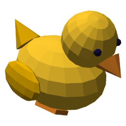
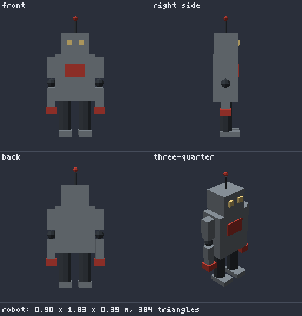
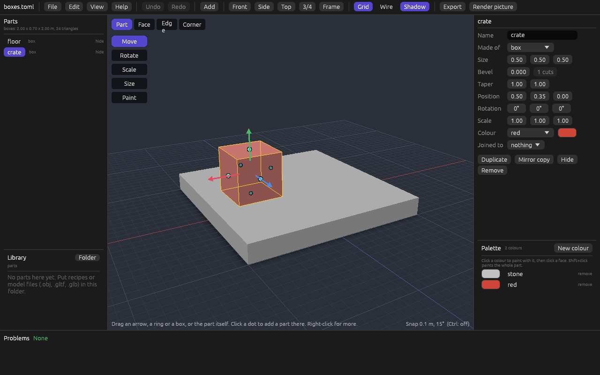
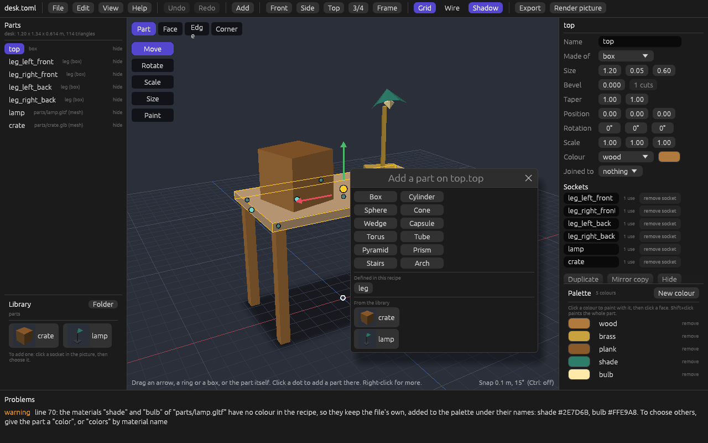
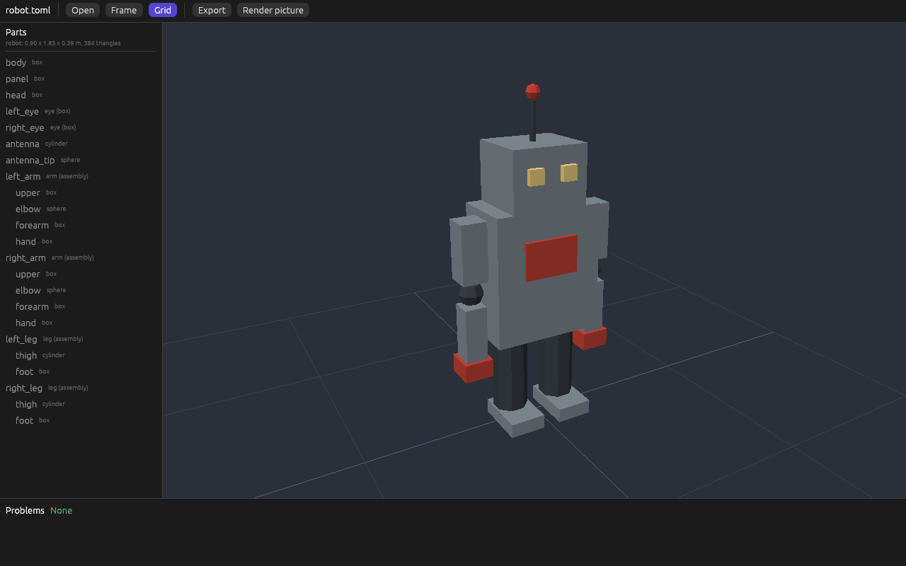

# Duck Mold



Duck Mold makes game-ready 3D models from parts. You describe a model in
a short file, a **recipe**: which parts it has, which part joins which,
and what colour each is. You can type the recipe, or build it with the
mouse in **Duck Mold Studio**, which writes the same file. Duck Mold
builds the model, tells you in words and numbers how it came out, and
writes a `.glb` file for the
[Duck Forge](https://github.com/mrguymrguy647-del/Duck-Forge) game engine.

It is not a sculpting program. It is an assembler: you don't push points
around, you name parts and say how they fit together. It belongs with
[Duck Quill](https://github.com/mrguymrguy647-del/duck-quill) (2D art)
and [Duck Echo](https://github.com/mrguymrguy647-del/Duck-Echo) (sound),
and like them it is made for two kinds of user: people who don't know
3D modelling or Rust, and AI agents.

**An AI agent?** Read [docs/AI_GUIDE.md](docs/AI_GUIDE.md), or run
`duck-mold guide`: the whole tool on one page, from scratch.

## Start the Studio on Windows, without a terminal

- **From a download:** get `DuckMold-<version>-windows.zip` from the
  [Releases](https://github.com/mrguymrguy647-del/Duck-Mold/releases)
  page, unzip it, and double-click `DuckMoldStudio.exe`. `READ ME
  FIRST.txt` in the folder says the rest. `Create desktop shortcut.bat`
  puts the duck on your desktop.
- **From a copy of this repository:** install Rust from
  <https://rustup.rs>, then double-click `Start Duck Mold Studio.bat`.
  It builds the Studio (a few minutes the first time) and starts it.
  `Create desktop shortcut.bat` puts a shortcut on your desktop.

The Studio opens on a page with **Open a model**, **New model** and the
recipes you opened lately. You can also drop a recipe file on
`DuckMoldStudio.exe`, or on its shortcut, to open it. No black console
window opens behind it.

The rest of this page builds a model by typing first, because that
shows what a recipe is; the Studio comes at step 6 of the quick start.

## A first model

```toml
version = 0
name = "tree"

[palette]
bark = "#6B4A2B"
leaf = "#3F8F4A"

[[parts]]
name = "trunk"
shape = "cylinder"
radius = 0.15
height = 1.2
color = "bark"

[[parts]]
name = "leaves"
shape = "cone"
radius = 0.7
height = 1.6
color = "leaf"
attach = "bottom"       # my socket...
to = "trunk.top"        # ...joins the trunk's socket
```

There are no positions in it. Every part has sockets (named points:
`top`, `bottom`, `left`, `right`, `front`, `back`, `center`), and
`attach` and `to` join one part's socket to another's. The cone sits on
the trunk because its `bottom` is joined to the trunk's `top`.

## Quick start

1. Install Rust from <https://rustup.rs> (version 1.95 or newer).
2. Get this repository, and in its folder run:

```bash
cargo build --release
```

The program is `target/release/duck-mold` (`target\release\duck-mold.exe`
on Windows). The first build takes under a minute.

3. Look at an example without writing anything:

```bash
target/release/duck-mold inspect examples/robot.toml
```

4. Build it:

```bash
target/release/duck-mold export examples/robot.toml
```

That writes `examples/robot.glb`. Any glTF viewer opens it: the 3D
Viewer that comes with Windows, Blender, or an online glTF viewer.

5. See it:

```bash
target/release/duck-mold render examples/robot.toml
```

That writes `examples/robot.png`, four views of the model on one sheet,
without opening a window:



6. Or open it in the Studio, the window where a model is built with the
   mouse:

```bash
target/release/duck-mold studio examples/robot.toml
```

Drag with the left mouse button to turn the model, with the right one
to slide it, and roll the wheel to come closer. The parts are listed on
the left, and what is wrong with the recipe (if anything) at the bottom.
Click a part, in the picture or in the list, to select it: it lights up
in both. (A part made of parts, like the robot's arm, is selected whole
first; click again for the part inside.)

The selected part's **properties** are on the right: its name, what it
is made of, its sizes, its colour (from the palette, or a new one), what
it is joined to, and its twist, with buttons to duplicate it, make a
mirror copy, or remove it. Changing a value changes the recipe file at
once, and only where it has to: comments and layout stay. A part that
comes from a definition says so first, and names every other part the
change would reach:

> Made from the definition "eye". Changing its shape, size or colour
> also changes: right_eye.

**Moving, turning and sizing a part.** Four tools stand down the left
edge of the picture, each with a key. They put handles on the selected
part:

| Tool | Key | Handles | Dragging one |
|---|---|---|---|
| Move | G | Three arrows: red, green, blue | Moves the part left-right, up-down or front-back. Dragging the part itself slides it over the ground. |
| Rotate | R | Three rings | Turns it, 15 degrees at a time. |
| Scale | S | Three small boxes, and one in the middle | Stretches it one way, or makes all of it bigger or smaller. Works on any part. |
| Size | T | A round knob on each face of a shape | Pulls that face out or in: changes the shape's own width, height, depth or radius. The face opposite stays where it is. |

- That is for a **free** part: one that is joined to nothing (a
  duplicate, say). A **joined** part slides along the surface it sits
  on, and has one ring, which twists it around its join. **Unjoin** in
  the properties panel makes it free, right where it is.
- Moves go in steps of 10 cm (1 cm when you are zoomed in close). Hold
  **Ctrl** to move freely.
- While you drag, the part moves under the pointer and a label shows
  the number. The recipe is written once, when you let go, so one drag
  is one step to undo. Escape lets go without changing anything.
- The same numbers are in the properties panel (Position, Rotation,
  Scale), to type.
- The ground is always under the lowest part, because a game stands a
  model on its underside. So lifting the lowest part leaves it on the
  ground and brings the others down, and lifting the only part shows
  nothing. The Studio says so when it happens.



**Adding parts.** There are two ways.

- **Add**, in the top bar, lists the shapes, the parts the recipe
  defines and the library. Pick one and it stands on the ground in the
  middle of what you are looking at, or just in front of whatever
  already stands there, joined to nothing. It is selected, with the
  Move arrows on it, so you can drag it straight away.
- The selected part's sockets show as small round dots. Click a dot
  and pick what to add there: one of the twelve shapes, or a
  part the recipe defines. The new part is about half the size of the
  one it sits on, has its colour, and is selected, ready to change.
- To join a part that is already there, drag it onto a dot of another
  part.
  The dots of the parts it could join light up while you drag. A joined
  part dropped on another part's surface goes to that point: the Studio
  declares a socket there (`on` a side, with a `shift`), or, if the
  part already has a socket of its own on that part, moves it.

Each of these is a `set`, `add`, `join`, `unjoin`, `add-socket` or
`set-socket` edit in the recipe file, the same ones `duck-mold edit`
makes.

**The parts library.** Under the parts list is the library: every
recipe and model file (`.obj`, `.gltf`, `.glb`) in the folder `parts`
next to your recipe, each with a small picture. They are offered in the
list that opens when you click a socket, below the shapes, and are added
the same way. The recipe then names the file (`file =
"parts/lamp.gltf"`): nothing is copied, and when the file changes, so
does every model that uses it. **Folder** chooses another folder. Try it
with `examples/desk.toml`, whose library is `examples/parts`.



**Undo and redo** (the buttons, or Ctrl+Z and Ctrl+Y) take back and
repeat every change, one at a time, as far back as 500 steps. Because
the Studio writes each change to the file at once, undo writes the
earlier text back to the file. A change another program made while the
Studio was open (an agent, a text editor) is a step too, called "Changed
outside the Studio": undo always takes back the latest change to the
file, whoever made it. The steps are forgotten when the Studio closes.

**Export** and **Render picture**, in the top bar, write the `.glb` and
the four-view picture next to the recipe: no terminal needed.

**The file is the model.** The Studio keeps no model of its own: it
shows the recipe file, and every change you make is written to it at
once, so there is nothing to save. When you (or an agent) save the
recipe in another program, the Studio builds it again. If the recipe has
a mistake, the Studio says so and keeps showing the last version that
built.



`duck-mold preview examples/robot.toml` opens the same window to look
only: nothing can be changed there.

## The commands

| Command | What it does |
|---|---|
| `duck-mold inspect <file>` | Checks a recipe, builds it in memory and reports on it. Writes nothing. Also measures a mesh file (`.obj`, `.gltf`, `.glb`). `--sockets` also lists every named socket and where it is. |
| `duck-mold export <recipe>` | Builds the recipe and writes the `.glb` next to it. `-o other.glb` writes it somewhere else. |
| `duck-mold render <file>` | Draws the model and writes a PNG next to it: front, right side, back and three-quarter views. `-o` writes it somewhere else; `--size 384` makes each view 384 pixels square (256 unless you say). Draws a mesh file (`.obj`, `.gltf`, `.glb`) as it is, too. |
| `duck-mold edit <recipe> <change>` | Makes one change to a recipe without typing it: `add`, `remove`, `rename`, `join`, `set`, `duplicate`, `add-color`, `set-color`, `add-socket`, `set-socket`. Only what has to change in the file changes. Prints the same report as `inspect`. `--dry-run` writes nothing. |
| `duck-mold new <recipe>` | Starts a new recipe: one box standing on the ground. Never writes over a file. |
| `duck-mold studio [recipe]` | Opens the Studio, the window where a model is built with the mouse. Every change it makes is a `duck-mold edit`, written to the recipe at once. It builds the model again whenever the recipe, or a file it uses, is saved by another program. |
| `duck-mold preview <file>` | Opens the Studio to look only: drag to orbit, right-drag to pan, wheel to zoom, Escape to quit. Also shows a mesh file (`.obj`, `.gltf`, `.glb`). |
| `duck-mold guide` | Prints the guide for AI agents. |
| `duck-mold help` | Lists the commands; `duck-mold inspect --help` explains one. |

Add `--json` to `inspect`, `export`, `render`, `edit` or `new` to get the
report as JSON, for an agent or a script.

`render` draws with Duck Forge's own renderer, so the picture shows the
model the way a Duck Forge game draws it. The same recipe always gives
the same picture, byte for byte. Each view is drawn from far away and
zoomed in, so it looks nearly flat, like a drawing, and every view is at
the same scale, so the model is the same size in each.

The program ends with code 0 when it worked, 1 when the recipe has
mistakes, and 2 when the command itself was wrong or a file couldn't be
read or written.

## What `inspect` tells you

```
robot  (examples/robot.toml)
  size         0.90 wide x 1.83 tall x 0.39 deep, in metres (x, y, z)
  triangles    384  (792 corners)
  ground       rests on the ground
  colours      4:  steel 96, dark 180, red 84, glow 24  (triangles each)
  parts        19
    body          box              12 triangles
    panel         box              12 triangles   on body.chest
    head          box              12 triangles   on body.neck
    ...
    right_arm     arm (assembly)   84 triangles   on body.right_arm, mirrored
    ...
  floating     none
  overlapping  none
ok: no problems found
```

- **size**: how big the model is.
- **triangles**: how many triangles it is made of. Fewer is cheaper for
  a game to draw.
- **ground**: whether it stands on the ground.
- **colours**: how much of it each palette colour paints.
- **parts**: every part, what it is and what it is joined to.
- **floating**: parts that touch nothing. Almost always a mistake.
- **overlapping**: parts that poke into other parts, and how deep.
  Sometimes meant (a nose pushed into a head), sometimes not.

So you can tell whether a model came out right without opening it.

## When a recipe has a mistake

Every mistake is listed at once, each with its file, its line, the field
and, where it can be guessed, the fix:

```
error: lamp.toml:12: parts[0].colour: there is no field "colour" here. Did you mean "color"?
error: lamp.toml:19: parts[1].color: there is no colour "bras" in the palette. Did you mean "brass"?
error: lamp.toml:21: parts[1].to: there is no part "bace" in this list. Did you mean "base"?
error: lamp.toml:26: parts[2].segments: 100 is too big. Allowed: 3 to 64.
```

(`parts[0]` is the first part: the counting starts at 0.)

## The ideas

- **The recipe is the model.** The `.glb` is rebuilt from the recipe
  every time, and the same recipe always gives exactly the same file. So
  keep the recipe; the `.glb` can always be made again.
- **Parts and sockets.** A part is a shape (box, cylinder, sphere, cone,
  wedge, capsule, torus, tube, pyramid, prism, stairs or arch; a box
  or a cylinder can have its edges cut with `bevel`, and a box, a
  cylinder or a tube a narrower top with `taper`), a mesh from a file (`.obj`, `.gltf` or `.glb`, from Blender or
  any modelling program), or an assembly of other parts.
  Parts are joined socket to socket, by name. A part can declare sockets
  of its own: `neck = { on = "top" }`.
- **Define once, use many times.** A part under `[define.leg]` can be
  used four times. `mirror = "x"` makes a right arm from a left arm.
- **A small palette.** A model's colours are a short list of names;
  every face gets one of them. `color` paints a whole part, `colors`
  paints single faces: `colors = { top = "grass" }`.
- **Directions.** x is right, y is up, z is forward; 1 unit is about a
  metre. A model faces forward, so its `front` is +z and its `left` is
  -x. These are Duck Forge's directions.

A recipe can be written as TOML (the examples) or as JSON
([examples/crate.json](examples/crate.json)); the fields are the same.

## Examples

| Recipe | Shows |
|---|---|
| [crate.toml](examples/crate.toml) | The smallest useful recipe: one box, two colours. |
| [table.toml](examples/table.toml) | A part defined once and used four times, on sockets the table top declares. |
| [tree.toml](examples/tree.toml) | One tier of needles used three times at three sizes. |
| [house.toml](examples/house.toml) | A roof assembled from two wedges; a door, windows and a chimney placed by sockets, and a skylight on the roof's `slope`. |
| [robot.toml](examples/robot.toml) | Parts made of parts, sockets passed on from inside, and a mirrored arm. |
| [desk.toml](examples/desk.toml) | Parts made elsewhere: a lamp from a glTF file (its stand painted from the palette, its shade and bulb keeping the file's colours) and a crate from a Duck Mold `.glb`. |
| [snowman.toml](examples/snowman.toml) | Sockets on curved surfaces: eyes and buttons that follow the snow, arms that lean out, a badge on a cone's slant. |
| [duck.toml](examples/duck.toml) | A ball stretched into a body with a three-number `scale`, parts placed at points of a round surface, one wing used twice. Its picture is the Studio's icon. |
| [dog.toml](examples/dog.toml) | `capsule`: a body lying down, a leg used four times, sockets on a round surface with a `facing` of their own. |
| [doughnut.toml](examples/doughnut.toml) | `torus`: a ring, a second one squashed for the icing, sprinkles at points of its surface, and a plate with a `bevel`. |
| [mug.toml](examples/mug.toml) | `tube`: a pipe widened towards the top with `taper`, its inside a different colour, and a ring on edge for the handle. |
| [temple.toml](examples/temple.toml) | `pyramid`: a roof on four columns, platforms with cut edges, and `stairs` up the front. |
| [barn.toml](examples/barn.toml) | `prism`: a ridged roof in one part, its ends coloured by name, and a silo with a round cap. |
| [slide.toml](examples/slide.toml) | `stairs`: steps up to a platform that is placed with `move`, and a ramp down the other side. |
| [gate.toml](examples/gate.toml) | `arch`: a doorway between two towers that are tapered and bevelled, defined once and used twice. |

Each is commented line by line.

## Using a model in Duck Forge

```rust
let robot = Mesh::load_glb("assets/robot.glb")?;
canvas.draw_mesh(&robot, &Transform::at(position), &camera);
```

The `.glb` keeps every named part's sockets, so a game can put things
on the model where the recipe joined its parts: a hat on `head.top`, a
sword in `right_arm.grip`. `duck-mold inspect robot.toml --sockets`
lists their names.

```rust
let model = duckforge::glb::GlbModel::load("assets/robot.glb")?;
let top = model.socket("head.top").unwrap();
let hat_at = robot_transform.apply(top.position());
```

Duck Forge reads Duck Mold's `.glb` files with the reader in
[docs/forge/duck_mold_glb.rs](docs/forge/duck_mold_glb.rs), a copy of
which is in Duck Forge. [docs/forge-handoff.md](docs/forge-handoff.md)
says what is in the file and how to keep the two copies the same.
A model faces +z, so a default Duck Forge camera sees it from behind:
see the handoff note.

## Documents

| | |
|---|---|
| [docs/AI_GUIDE.md](docs/AI_GUIDE.md) | For AI agents: the commands and the recipe format from scratch. |
| [docs/recipe-format.md](docs/recipe-format.md) | Every field of a recipe, with its default and range. |
| [docs/forge-handoff.md](docs/forge-handoff.md) | What is inside a `.glb`, and what Duck Forge must do to load one. |
| [DESIGN.md](DESIGN.md) | Why Duck Mold is the way it is, decision by decision, in plain words. |
| [PHASE0_REPORT.md](PHASE0_REPORT.md) | Phase 0: what works, what doesn't yet, and what comes next. |
| [PHASE1_REPORT.md](PHASE1_REPORT.md) | Phase 1: pictures, the preview window, sockets on surfaces and in the `.glb`, `twist`, glTF import. |
| [PHASE2_REPORT.md](PHASE2_REPORT.md) | Phase 2: the Studio, the edit commands, undo, the parts library, the Windows download. |

## Project layout

```
Duck-Mold/
├── .github/workflows/ci.yml   the tests on Windows and Linux, for every push
├── .github/workflows/release.yml  makes the Windows download (a zip)
├── Start Duck Mold Studio.bat double-click: builds the Studio and starts it
├── Create desktop shortcut.bat    double-click: a shortcut on the desktop
├── release/                   what goes in the download beside the programs
├── Cargo.toml                 the workspace: four crates, built together
├── examples/                  eight recipes to read and change, and parts/ for files they use
├── docs/                      the guide, the format, the Duck Forge handoff
├── tests/golden/              the examples' exact output (.glb, report, picture)
└── crates/
    ├── duck-mold-core/        the library: everything except pictures and the command line
    │   ├── src/
    │   │   ├── source.rs      TOML or JSON text -> one tree that remembers line numbers
    │   │   ├── issue.rs       mistakes as data: file, line, field, message, fix
    │   │   ├── recipe.rs      the recipe's fields, read from that tree and checked
    │   │   ├── load.rs        the files a recipe names: palettes, recipes, meshes
    │   │   ├── math.rs        points, turns, and an exact sine and cosine
    │   │   ├── shapes.rs      the twelve shapes, bevel and taper
    │   │   ├── mesh.rs        reading .obj files
    │   │   ├── gltf.rs        reading .gltf and .glb files
    │   │   ├── assemble.rs    parts, sockets, joins, nesting, colour
    │   │   ├── model.rs       the built model: a tree of parts and their faces
    │   │   ├── glb.rs         writing (and reading back) .glb
    │   │   ├── inspect.rs     size, ground, floating and overlapping parts
    │   │   ├── edit/          the edits: one change to a recipe's text, and nothing else
    │   │   └── tools.rs       what the commands do, for any front end
    │   └── tests/             one file of tests per step
    ├── duck-mold-view/        pictures (`render`), and all the Studio does, with no window
    ├── duck-mold-studio/      the Studio's window (egui): the `DuckMoldStudio` program
    │   └── assets/            its icon: a picture of examples/duck.toml
    └── duck-mold-cli/         the `duck-mold` program: reads the command line, prints
```

## Working on Duck Mold

```bash
cargo test --workspace
```

```bash
cargo fmt --all -- --check
```

```bash
cargo clippy --workspace --all-targets -- -D warnings
```

All three must pass before a commit. GitHub runs them again, on Windows
and on Linux, for every push and pull request
(`.github/workflows/ci.yml`).

The Studio is a program of its own, `DuckMoldStudio`, so the `duck-mold`
command holds no window library. `duck-mold studio` and `duck-mold
preview` start the `DuckMoldStudio` that sits next to `duck-mold`, where
`cargo build` puts both. A machine with no screen, or an agent, can
build the command alone, which is much quicker:

```bash
cargo build --release -p duck-mold-cli
```

The Studio's window is made with egui, like Duck Quill and Duck Forge's
Studio. Its screens are tested with no window (`egui_kittest`): the
tests click through the real screens on Windows and Linux
(`tests/screens.rs`), and on Linux one more test compares pictures of
whole screens with the ones stored in
`crates/duck-mold-studio/tests/screens/` (`tests/pictures.rs`; it draws
them one after another, because the software driver crashed when
several were drawn at once). That needs a Vulkan driver;
the software one will do (on Ubuntu or Debian, `sudo apt install
mesa-vulkan-drivers`). After a change that is meant to be seen, store
the new pictures with

```bash
UPDATE_SNAPSHOTS=1 cargo test -p duck-mold-studio --test pictures
```

The tests include **golden files**: `tests/golden/` holds the exact
`.glb` and the exact report for each example, and the tests compare
every byte. If you change an example or the output on purpose, accept
the new files with

```bash
DUCK_MOLD_ACCEPT=1 cargo test -p duck-mold-cli --test golden
```

and say in the commit why they changed.
